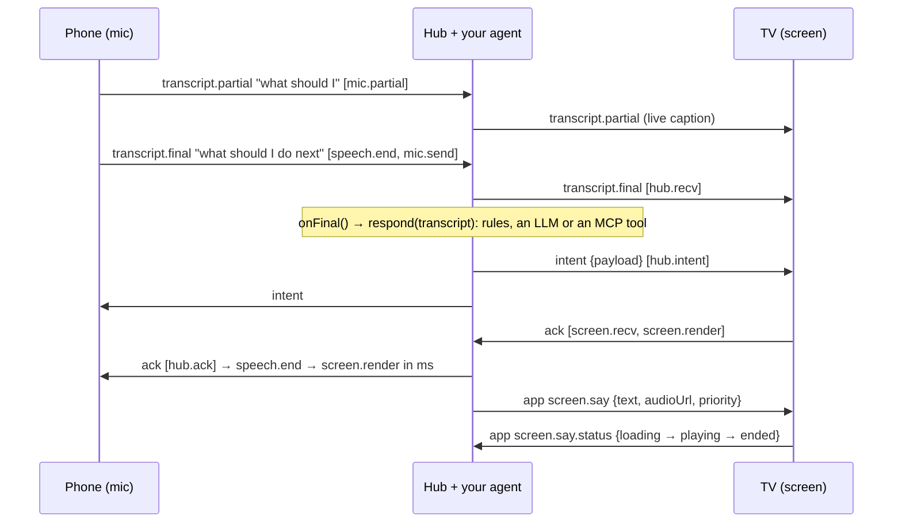

# tv-voice-bridge

**A voice back-and-forth harness for TV apps and agents.** The phone listens, your app or agent answers, the TV shows the answer and says it, and you get a timestamp for every hop.

```
phone speech  →  your app or agent  →  TV renders  →  TV speaks (screen.say)  →  playback confirmed
```

`tv-voice-bridge` has three parts:
- a small WebSocket protocol ([PROTOCOL.md](PROTOCOL.md));
- a Node hub;
- a framework-agnostic client for React Native for Vega, web TVs and Node.

The phone's own recognizer turns speech into text. Your `onFinal` handler, whether rules, an LLM or an MCP client, decides what it means and what the TV should say. The bridge carries the text both ways and confirms that the TV rendered and played the result. Pairing is the smallest part: the TV shows a 4-character code, and the phone joins with it.

> MIT licensed. Package name and scope (`@rackboard/…`) are placeholders, and the package is marked `"private": true` until it is published. Current version: **0.2.0** (protocol v1; see [CHANGELOG.md](CHANGELOG.md)).

## The round trip



### Per-hop latency model

Every utterance carries `hops: [{hop, at}]` in **hub clock**. Each client estimates its offset to the hub from `welcome` and ping/pong samples, keeping the lowest-RTT one. Hops are appended in order and never reordered:

| Leg | What it measures |
|---|---|
| `speech.end → mic.send` | The phone recognizer's tail: from silence to a final result |
| `mic.send → hub.recv` | Phone to hub network |
| `hub.recv → hub.intent` | **Your app or agent** (`onFinal`) |
| `hub.intent → screen.recv` | Hub to TV network |
| `screen.recv → screen.render` | The TV drawing the result (stamp after the frame that shows it) |
| `screen.render → hub.ack` | TV to hub (the confirmation, not user-visible) |
| `screen.say` sent → `screen.say.status: playing` | The TV loading and starting the reply's audio (`at` is hub clock) |

`latency(ack.hops).span('speech.end', 'screen.render')` gives the user-visible number, and `.legs` gives each leg. Taps use `input.end` instead of `speech.end`. The table below was measured in the first app built on the bridge. The Vega rows come from the **Vega Virtual Device** (SDK 0.24), not a physical stick.

| Path | Measured |
|---|---|
| Phone tap → VVD render (reverse port forward) | 6–69 ms (hub → screen 0–38 ms, render 5–27 ms) |
| Hub `screen.say` → audio playing on the VVD (S3 presigned mp3) | 166–224 ms after load; tap → audio start 378–391 ms |
| Web TV, same host | under 40 ms end to end |

## Why

Fire TV's Vega OS has **no app-level speech-to-text API**. Amazon's developer forum says so in two threads: [Speech-to-Text API for a WebView app](https://community.amazondeveloper.com/t/speech-to-text-api-for-a-webview-app/29064) and [Speech-to-text support with manual mic trigger](https://community.amazondeveloper.com/t/speech-to-text-support-with-manual-mic-trigger/27863). What a Vega app gets instead is limited:

- **Keyboard dictation.** The only speech-to-text is the system keyboard's one-shot dictation into a focused text field.
- **No WebView mic.** WebView microphone access (`getUserMedia` audio) is not supported for third-party apps ([forum](https://community.amazondeveloper.com/t/issues-with-microphone-access-for-jitsi-integration-on-vega-os/28161)).
- **A privileged raw-audio API.** [`AudioRecordStream`](https://developer.amazon.com/docs/vega-api/0.24/classes.AudioRecordStreamBuilder.amazon-devices_keplerscript-audio-lib.html) exists behind the `com.amazon.audio.privilege.microphone.access` privilege with a run-time grant. It returns raw PCM with no recognizer, so you would ship your own speech-to-text. We have not tested which microphone it reaches on a Fire TV Stick.

So a TV app that wants a conversation needs speech-to-text somewhere else. Everyone in the room already has a phone with a good mic and a recognizer, so the phone listens. The hard parts are the plumbing:
- getting the words to *this* TV;
- getting an answer back out loud, with audio Vega's media player will actually play;
- seeing where the time goes;
- staying connected through TV-runtime quirks and hub restarts.

## Why not…

- **Keyboard dictation?** It suits a search box. The user holds the remote's mic button and one final string lands in a focused `TextInput`. There are no partials, the app cannot start listening on its own, and there is no way back (the TV saying something) and no timing. A conversation needs every one of those.
- **[Matter Casting](https://developer.amazon.com/docs/vega/0.24/vega-matter-casting-integration.html)?** It is the official phone-to-Vega companion path, and it covers launching content and media-playback controls. It carries no free-form app messages, audio or speech. The two fit together: use Matter to launch your app, and the bridge to talk to it.
- **A bare socket library?** Generic WebSocket rooms give you transport. You would still build all of the following:
  - roles and pairing codes;
  - transcript, intent and ack semantics;
  - a speech back-channel with playback status;
  - hop timing with clock sync;
  - reconnect and dead-link detection for TV runtimes;
  - a conformance suite so a second platform can join.

  That is this package.

## Used by

- **Speaking Mirror**, a Bee speech coach whose TV mirror runs on the bridge.
- **Rack Board**, a Fire TV training board: the phone logs sets by voice and the TV coaches out loud.

## Install

Not on npm. The GitHub repo is **private for now**. Once it is public:

```bash
npm install github:Zen-cronic/tv-voice-bridge     # builds dist/ on install (the prepare script)
```

Until then, pack it and install the tarball:

```bash
npm pack --pack-destination ../my-app/vendor     # in this repo; builds first
cd ../my-app && npm install ./vendor/rackboard-tv-voice-bridge-0.2.0.tgz
```

For a live link while you edit the bridge (changes show up without re-packing), use `npm link`:

```bash
npm run build && npm link                         # in this repo
cd ../my-app && npm link @rackboard/tv-voice-bridge
```

A linked package is a symlink outside the app's folder, so React Native for Vega's Metro bundler may not follow it without extra `watchFolders` config. Prefer the tarball for Vega builds and for anything a fresh clone must install. The hub needs `ws` (an optional peer dependency); the client needs nothing.

## Quick start: an agent on a web TV (2 minutes)

```bash
npm install && npm run build
node examples/agent/agent.mjs        # TV: http://localhost:8800/   phone: the URL shown on the TV
```

Open the TV page on a screen and the shown URL on a phone on the same Wi-Fi, then talk (or type). The TV shows what you said and speaks the agent's reply. [`examples/agent/agent.mjs`](examples/agent/agent.mjs) is 39 lines, and `respond(transcript)` is the only part you replace:

```js
// LLM:  respond = async (t) => (await llm.chat({ messages: [...history, { role: 'user', content: t }] })).text
// MCP:  respond = async (t) => (await mcp.callTool({ name: 'answer', arguments: { question: t } })).content[0].text
startAgent({ respond, timeoutMs: 8000, fallback: "Sorry, I didn't catch that." });
```

`respond` is time-boxed and may throw; the TV always answers. The default responder is offline and deterministic, and `test/agent.test.ts` walks the whole round trip with a stub. [`examples/minimal-web-tv/server.mjs`](examples/minimal-web-tv/server.mjs) is the plain echo version. Browser speech recognition on the phone needs a secure context: `localhost`, or https on the LAN (for example a local CA such as mkcert, trusted on the phone once). The typed input works over plain http.

## Quick start: React Native for Vega

[`examples/minimal-vega/App.tsx`](examples/minimal-vega/App.tsx) is a whole screen in about 80 lines. It is illustrative and not type-checked here, because it needs a Vega project's dependencies. Installed from a tarball, the package needs no Metro changes, because Metro resolves `dist/` through `exports`.

```tsx
const tv = new BridgeClient({ url: 'ws://127.0.0.1:8800/ws', role: 'screen' });
tv.on('welcome', (w) => setCode(w.code));                                  // show the code (and a QR of w.joinUrl)
tv.on('status', (s) => setStatus(s));                                      // connecting / open / reconnecting / closed
tv.on('intent', (m) => { render(m.payload); requestAnimationFrame(() => tv.ack(m)); });
tv.onSay((line) => play(line.audioUrl) /* https only on Vega */ || caption(line.text, line.durationMs));
tv.connect().catch(() => undefined);                                       // keeps retrying until tv.close()
```

**Vega notes** (verified on the Vega Virtual Device, SDK 0.24):

- **WebSocket and the VVD.** React Native's global `WebSocket` works. On the VVD, reach a hub on your machine with a **reverse port forward**, `vega device start-port-forwarding --port 8800 --forward false`, and connect to `ws://127.0.0.1:8800/ws`. The emulator's NAT alias `10.0.2.2` intermittently dropped WebSocket frames larger than about 1.4 KB in our tests. On a real stick, use the dev machine's LAN IP.
- **Built-in client defences.** The client reassembles messages that arrive split across events, and its heartbeat drops a link that goes silent even when `onclose` never fires.
- **Audio must be public https.** The W3C media player (`@amazon-devices/react-native-w3cmedia`) **plays only publicly trusted https URLs**. It refuses `http://` and a local CA, and raw-mp3 MSE never initialized for us. For `screen.say` audio, upload the clip and send a presigned https URL (we use S3 with a 1 h expiry), or fall back to captions and report `no-audio`.
- **Metro, only when bundling from source.** The package source uses TS-ESM imports (`./protocol.js`), so map them to `.ts` in a custom `resolveRequest`. A custom resolver replaces Vega's own, so also re-apply the `react-native` → `@amazon-devices/react-native-kepler` mapping. Without that mapping the bundle ships core React Native and the app aborts at launch. See [`examples/minimal-vega/metro.config.js`](examples/minimal-vega/metro.config.js).
- **`performance.timeOrigin`.** It may be missing on some runtimes. The client falls back on its own; polyfill it as `Date.now() - performance.now()` if your code stamps `receivedAt` itself.

## Hub (Node)

```ts
import http from 'node:http';
import { BridgeHub } from '@rackboard/tv-voice-bridge/hub';   // needs `ws`

const server = http.createServer(app);
const hub = new BridgeHub({
  server,                                   // or [httpServer, httpsServer]: one hub, several listeners
  joinUrl: (code) => `https://${lanIp}:8443/p/${code}`,
  onFinal: async (room, msg) => {
    const reply = await respond(msg.text);                     // rules, an LLM, an MCP tool: your call
    hub.say(room, { id: nextId(), text: reply, audioUrl: await tts(reply), priority: 'high' });
    return { name: 'reply', ok: true, payload: { text: msg.text, reply } };   // fanned out as an `intent`
  },
  onApp: (room, msg) => null,               // taps, nav, playback status; return an intent to answer a tracked one
  rateKey: (req) => String(req.headers['x-forwarded-for'] ?? req.socket.remoteAddress),   // only behind a proxy you trust
});
```

The hub is defensive by construction. No frame, upgrade request or app callback can throw out of it. Every field of every message is validated, and anything bad gets a typed error instead of a crash. Hub options:

| Option | Default | What it does |
|---|---|---|
| `roomGraceMs` | 60 s | A room closes this long after its last screen leaves |
| `heartbeatMs` | 15 s | Protocol ping interval; two missed pings terminate the socket |
| `limits.maxMessageBytes` | 256 KiB | Frame cap |
| `limits.maxRooms` | 10,000 | Rooms the hub keeps at once |
| `limits.maxPeersPerRoom` | 32 | Peers per room |
| `limits.messagesPerSecond` | 100 | Per socket |
| `limits.hellosPerMinute` | 120 | Per rate key |
| `limits.codeMissesPerMinute` | 30 | Hellos naming a code no live room has (mic or screen), per rate key |
| `limits.maxBufferedBytes` | 1 MiB | Above this, captions and untracked frames to a slow peer are dropped |
| `limits.maxBufferedBytesHard` | 8 MiB | Above this, the slow peer is disconnected |

`hub.stats` counts bad messages, rate limits, backpressure drops, heartbeat timeouts, handler errors and expired rooms.

## Mic (phone)

```ts
import { BridgeClient, latency } from '@rackboard/tv-voice-bridge';
const phone = new BridgeClient({ url: `wss://${location.host}/ws`, role: 'mic', code });
phone.on('ack', (a) => show(latency(a.hops).span('speech.end', 'screen.render')));   // ms, across three devices
phone.on('repair', () => askToScanAgain());   // the TV's room is gone for good
await phone.connect();
recognition.onresult = (e) => { /* sendPartial(text, id) while speaking, sendFinal(text, { speechEndAt, utteranceId: id }) at the end */ };
```

**Staying connected.** With `reconnect` on (the default), the client keeps the link up until `close()`:

- **Backoff:** capped exponential, 250 ms doubling to 10 s, with half of each delay random.
- **Dead links:** the heartbeat pings every 10 s and drops the link after 25 s of silence.
- **Hub restarts:** a phone that gets back before the TV keeps retrying `unknown-code` while the TV re-creates its room with the same code. After `repairAfterMs` (60 s) it stops with status `repair`.
- **Fatal answers:** `version`, `id-in-use`, and a wrong code on a first pairing stop the client.

To keep a `clientId` across page reloads, persist **both** `client.clientId` and `client.resumeToken` and pass them back in. The token proves that the new connection owns the id. Never display or log the token.

## Protocol

[PROTOCOL.md](PROTOCOL.md) is the spec. It covers framing, every message with field limits, who may send what, routing, pairing and room lifetime, identity, liveness, errors, hub-clock hops, `screen.say`, backpressure, and the versioning rules. Version `1` has two revisions, which interoperate both ways. In short:

| `type` | Direction | Notes |
|---|---|---|
| `hello` / `welcome` / `peers` | client ↔ hub | A mic sends a live `code`; a screen may send one to resume its room |
| `transcript.partial` / `transcript.final` | mic → hub → **screens** (+ `onFinal`) | Live caption, then the final text |
| `intent` | hub → **room** | What your app or agent understood |
| `ack` | screen → hub → **mics** | Sent after the frame that shows the intent |
| `app` | any → hub | Side channel. `screen.say` (hub → screens) and `screen.say.status` (screen → hub) ride on it |
| `ping` / `pong` | client ↔ hub | Clock sync and liveness |
| `error` | hub → client | `unknown-code`, `bad-message`, `version`, `handler-failed`, `rate-limited`, `id-in-use`, `full`, `not-allowed` |

## Security notes

- **Codes are not authentication.** A code is **4 characters from a 31-character alphabet** (923,521 combinations). Anyone who can see the TV can join, which is the point in a living room and wrong for anything sensitive.
- **Guessing is throttled.** After 30 hellos a minute from one rate key that name a code no live room has, hellos naming a code are refused. That includes a screen probing codes, since a screen may join a room by its code. Codes are generated with the platform CSPRNG and never collide with a live room.
- **Rooms do not outlive the TV.** A mic can join only a room whose screen is present, or left less than `roomGraceMs` ago. Rooms live in memory and disappear when the hub restarts; the TV re-creates its code on reconnect.
- **Behind a tunnel or reverse proxy, set `rateKey`.** There, every client shares one remote address. Serve **https/wss** beyond the LAN, rotate codes per session, and consider an on-screen confirm.
- **`clientId` is not a secret.** It is shown to the room. A live `clientId` can be taken over only with its `resumeToken`, or once the holder stops answering pings.
- **`screen.say` audio URLs are bearer links.** Use short-lived presigned URLs, not public buckets, and never log the query string.
- **The hub runs no LLM and stores nothing.** What `onFinal` does with transcripts is your app's privacy surface.

## Known limits

- **Measured numbers are VVD and web TV only.** No physical Fire TV Stick run is included.
- **`AudioRecordStream` is untested.** We have not tested which microphone it reaches on a stick (see Why).
- **No end-to-end encryption.** Transport security is TLS between each device and the hub.
- **One hub process holds all rooms in memory.** There is no clustering.
- **The Vega example is illustrative,** and it is not type-checked in this repo.

## Tests

`npm test` runs 92 tests in 6 files:

- **Protocol conformance** (`test/conformance.test.ts`, 36), the reference for second implementations:
  - wire vectors for every message type;
  - field-level validation;
  - the hub as a black box over raw sockets: refusals, version, pairing, code normalization, `id-in-use`, 0.1 compatibility, role rules, handler failure;
  - routing, hop order, and `screen.say`.
- **Hub robustness** (`test/robustness.test.ts`, 23): every input that crashed the 0.1.0 hub (non-string `code`, invalid UTF-8, a reserved opcode, an oversized frame, a bad upgrade target, throwing callbacks). It also covers room lifetime, collision-free codes, brute-force and rate limits, capacity, dead-holder takeover, heartbeat and backpressure.
- **Client resilience** (`test/client.test.ts`, 17): backoff, split-frame reassembly, dead links without `onclose`, connect timeout, timer hygiene, clock-offset reset, and real hub restarts (re-join and re-pair).
- **Client and hub behaviour** (`test/bridge.test.ts`, 10): pairing, resume, end-to-end hops, partials, taps, two mics.
- **Examples** (`test/example.test.ts`, 3; `test/agent.test.ts`, 3): the web TV server, and the agent round trip with a stubbed `respond`.

## Development

Requires Node 20 or later (developed on Node 24).

```bash
npm install              # dev dependencies only; also builds dist/ (prepare)
npm run typecheck        # tsc --noEmit over src/ and test/
npm test                 # vitest: 92 tests, no build needed (tests import src/)
npm run build            # cleans, then tsc -> dist/ (ESM + .d.ts + source maps)
npm pack --dry-run       # dist/, src/, README.md, PROTOCOL.md, CHANGELOG.md, LICENSE (no tests or examples)
```

`exports` point at `dist/`. A `source` condition points at `src/`, so a monorepo or a git submodule can consume the TypeScript directly (`tsx -C source`, Vite `resolve.conditions`, TypeScript `customConditions`).

### Contributing

Keep the wire protocol compatible within v1 (see the versioning rules in [PROTOCOL.md](PROTOCOL.md#12-versioning-rules)). Add a vector to `test/conformance.test.ts` for any new message, field, topic or routing rule. Run `npm run typecheck && npm test` before sending a change.

## License

MIT © 2026 Kaung Zin Hein
