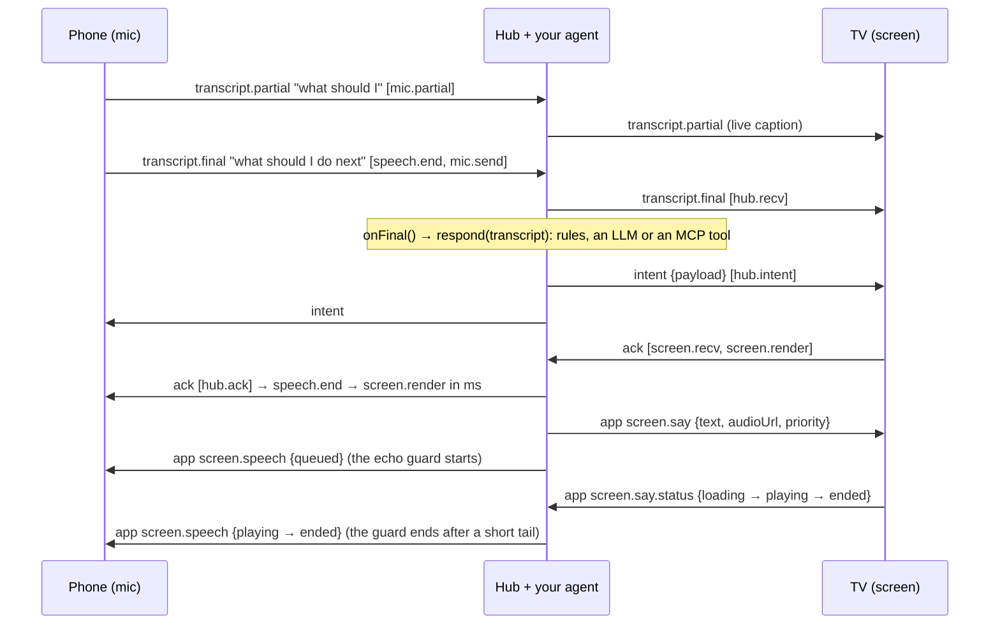
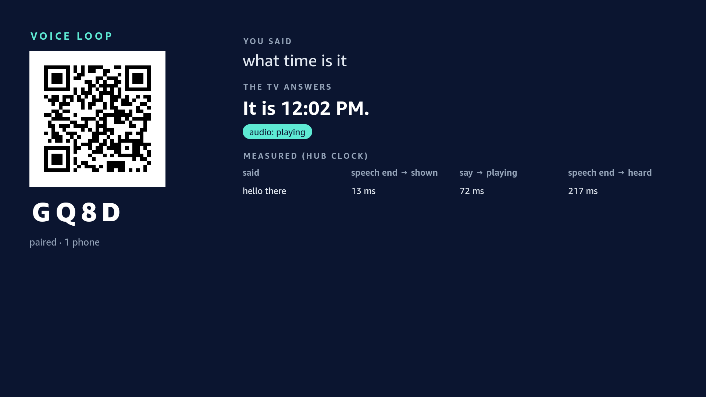

# tv-voice-bridge

**A voice back-and-forth harness for TV apps and agents.** The phone listens, your app or agent answers, the TV shows the answer and says it, and you get a timestamp for every hop.

```
phone speech  →  your app or agent  →  TV renders  →  TV speaks (screen.say)  →  playback confirmed
```

The phone's own recognizer turns speech into text. Your `onFinal` handler, whether rules, an LLM or an MCP client, decides what it means and what the TV should say. The bridge carries the text both ways, confirms that the TV rendered and played the result, and keeps the TV's own voice from coming back through the phone's microphone. Pairing is the smallest part: the TV shows a 4-character code (and a QR code), and the phone joins with it.

What is in the package:

| Import | What it is |
|---|---|
| `tv-voice-bridge` | The framework-agnostic client for both roles (React Native for Vega, web TVs, Node), plus the protocol types |
| `…/phone` | The voice half for a phone browser page: Web Speech in, transcripts out, with the [echo guard](#the-echo-guard) and barge-in |
| `…/react` | `useVoiceBridge()` and `<PairingQr>` for the TV, with no native dependencies |
| `…/hub` | The Node hub, and the `tv-voice-bridge-hub` CLI |
| `…/qr` | A dependency-free QR Code encoder for the pairing screen |
| `…/vega` | `createVegaSayPlayer()`: the TV speaks back on Vega OS, from a plain-http hub ([below](#the-tv-speaks-back-on-vega)) |
| [PROTOCOL.md](PROTOCOL.md) | The wire protocol (v1), for a second implementation on another platform |

> MIT licensed. The package is `tv-voice-bridge`; it is marked `"private": true` and not on npm yet, so install it from git or a packed tarball (below). Current version: **0.3.0** (protocol v1, revision 3; see [CHANGELOG.md](CHANGELOG.md)).

## The whole loop in one command

```bash
npm install && npm run example
```

[`examples/loop/loop.mjs`](examples/loop/loop.mjs) runs a hub, a TV and a phone in one process. The phone's recognizer is scripted and the TV has no speaker; everything else is the library's own code. For each utterance it prints the hop timeline. While the TV "talks", the phone also hears the reply, as a phone in the same room would, and the echo guard drops it. The output looks like this (in-process, this machine, so the network legs are near zero):

```
"what should I do next"  ->  TV says "Next up: three sets of squats."
  mic.send -> hub.recv              0 ms
  hub.recv -> hub.intent            0 ms
  hub.intent -> screen.recv         0 ms
  screen.recv -> screen.render      0 ms
  speech.end -> screen.render       2 ms   (heard -> on screen)
  say -> playing                    1 ms   (reply dispatched -> TV reports sound)
...
echo guard: 3 of 3 replies heard by the phone were dropped; the TV received 3 transcripts, all from the user
```

## The round trip



### Per-hop latency model

Every utterance carries `hops: [{hop, at}]` in **hub clock**. Each client estimates its offset to the hub from `welcome` and ping/pong samples, keeping the lowest-RTT one. Hops are appended in order and never reordered:

| Leg | What it measures |
|---|---|
| `speech.end → mic.send` | The phone recognizer's tail: from silence to a final result |
| `mic.send → hub.recv` | Phone to hub network |
| `hub.recv → hub.intent` | **Your app or agent** (`onFinal`) |
| `hub.intent → screen.recv` | Hub to TV network |
| `screen.recv → screen.render` | The TV drawing the result (stamp after the frame that shows it) |
| `screen.render → hub.ack` | TV to hub (the confirmation, not user-visible) |
| `screen.say` sent → `screen.say.status: playing` | The TV loading and starting the reply's audio (`at` is hub clock) |

`latency(ack.hops).span('speech.end', 'screen.render')` gives the user-visible number, and `.legs` gives each leg. Taps use `input.end` instead of `speech.end`. `./phone` also stamps `speech.start`, so `speech.start → speech.end` is how long the user spoke. The table below was measured in the first app built on the bridge. The Vega rows come from the **Vega Virtual Device** (SDK 0.24), not a physical stick.

| Path | Measured |
|---|---|
| Phone tap → VVD render (reverse port forward) | 6–69 ms (hub → screen 0–38 ms, render 5–27 ms) |
| Hub `screen.say` → audio playing on the VVD (S3 presigned mp3) | 166–224 ms after load; tap → audio start 378–391 ms |
| The whole voice loop on the VVD, plain-http hub, fragmented MP4/AAC ([`examples/vega-voice-loop`](examples/vega-voice-loop)) | speech end → shown 11–46 ms; say → playing 72–175 ms; **speech end → reply audible 217–322 ms** (4 of 4 replies played to the end) |
| Web TV, same host | under 40 ms end to end |

## Why

Fire TV's Vega OS has **no app-level speech-to-text API**. Amazon's developer forum says so in two threads: [Speech-to-Text API for a WebView app](https://community.amazondeveloper.com/t/speech-to-text-api-for-a-webview-app/29064) and [Speech-to-text support with manual mic trigger](https://community.amazondeveloper.com/t/speech-to-text-support-with-manual-mic-trigger/27863). What a Vega app gets instead is limited:

- **Keyboard dictation.** The only speech-to-text is the system keyboard's one-shot dictation into a focused text field.
- **No WebView mic.** WebView microphone access (`getUserMedia` audio) is not supported for third-party apps ([forum](https://community.amazondeveloper.com/t/issues-with-microphone-access-for-jitsi-integration-on-vega-os/28161)).
- **A privileged raw-audio API.** [`AudioRecordStream`](https://developer.amazon.com/docs/vega-api/0.24/classes.AudioRecordStreamBuilder.amazon-devices_keplerscript-audio-lib.html) exists behind the `com.amazon.audio.privilege.microphone.access` privilege with a run-time grant. It returns raw PCM with no recognizer, so you would ship your own speech-to-text. We have not tested which microphone it reaches on a Fire TV Stick.

So a TV app that wants a conversation needs speech-to-text somewhere else. Everyone in the room already has a phone with a good mic and a recognizer, so the phone listens. The hard parts are the plumbing:
- getting the words to *this* TV;
- getting an answer back out loud, with audio Vega's media player will actually play;
- seeing where the time goes;
- staying connected through TV-runtime quirks and hub restarts.

## Why not…

- **Keyboard dictation?** It suits a search box. The user holds the remote's mic button and one final string lands in a focused `TextInput`. There are no partials, the app cannot start listening on its own, and there is no way back (the TV saying something) and no timing. A conversation needs every one of those.
- **[Matter Casting](https://developer.amazon.com/docs/vega/0.24/vega-matter-casting-integration.html)?** It is the official phone-to-Vega companion path, and it covers launching content and media-playback controls. It carries no free-form app messages, audio or speech. The two fit together: use Matter to launch your app, and the bridge to talk to it.
- **A bare socket library?** Generic WebSocket rooms give you transport. You would still build all of the following:
  - roles and pairing codes;
  - transcript, intent and ack semantics;
  - a speech back-channel with playback status;
  - hop timing with clock sync;
  - reconnect and dead-link detection for TV runtimes;
  - a conformance suite so a second platform can join.

  That is this package.

## Used by

- **Speaking Mirror**, a Bee speech coach whose TV mirror runs on the bridge.
- **Rack Board**, a Fire TV training board: the phone logs sets by voice and the TV coaches out loud.

## Install

Not on npm. The GitHub repo is **private for now**. Once it is public:

```bash
npm install github:Zen-cronic/tv-voice-bridge     # builds dist/ on install (the prepare script)
```

Until then, pack it and install the tarball:

```bash
npm pack --pack-destination ../my-app/vendor     # in this repo; builds first
cd ../my-app && npm install ./vendor/tv-voice-bridge-0.3.0.tgz
```

For a live link while you edit the bridge (changes show up without re-packing), use `npm link`:

```bash
npm run build && npm link                         # in this repo
cd ../my-app && npm link tv-voice-bridge
```

A linked package is a symlink outside the app's folder, so React Native for Vega's Metro bundler may not follow it without extra `watchFolders` config. Prefer the tarball for Vega builds and for anything a fresh clone must install. The hub needs `ws` (an optional peer dependency); the client needs nothing. `./react` needs `react` (18 or later) and a `react-native` that your bundler resolves (React Native for Vega, or react-native-web); both are optional peer dependencies that only `./react` imports.

## Quick start: an agent on a web TV (2 minutes)

```bash
npm install && npm run build
node examples/agent/agent.mjs        # TV: http://localhost:8800/   phone: the URL shown on the TV
```

Open the TV page on a screen and the shown URL on a phone on the same Wi-Fi, then talk (or type). The TV shows what you said and speaks the agent's reply. [`examples/agent/agent.mjs`](examples/agent/agent.mjs) is 39 lines, and `respond(transcript)` is the only part you replace:

```js
// LLM:  respond = async (t) => (await llm.chat({ messages: [...history, { role: 'user', content: t }] })).text
// MCP:  respond = async (t) => (await mcp.callTool({ name: 'answer', arguments: { question: t } })).content[0].text
startAgent({ respond, timeoutMs: 8000, fallback: "Sorry, I didn't catch that." });
```

`respond` is time-boxed and may throw; the TV always answers. The default responder is offline and deterministic, and `test/agent.test.ts` walks the whole round trip with a stub. [`examples/minimal-web-tv/server.mjs`](examples/minimal-web-tv/server.mjs) is the plain echo version. Browser speech recognition on the phone needs a secure context: `localhost`, or https on the LAN (for example a local CA such as mkcert, trusted on the phone once). The typed input works over plain http.

## Quick start: a TV screen with the React hook

`./react` wraps the client for a React or React Native TV. It runs on React Native for Vega and react-native-web, and draws the QR code with plain `View`s.

```tsx
import { PairingQr, useVoiceBridge } from 'tv-voice-bridge/react';

export function Screen() {
  const tv = useVoiceBridge({
    url: 'ws://192.168.1.20:8790/ws',
    player: (line, ctl) => {                          // play line.audioUrl, or a local TTS of line.text
      const stop = myPlayer.play(line, { onStart: ctl.playing, onEnd: ctl.ended, onError: ctl.error });
      return stop;                                    // called when a high-priority line or a barge-in interrupts
    },
    onIntent: (m) => applyToMyState(m.payload),        // the ack is sent after the frame that shows it
  });
  if (tv.status !== 'paired') return <PairingQr value={tv.joinUrl ?? ''} size={320} />;   // plus tv.code as text
  return <Answer heard={tv.final?.text} live={tv.partial} saying={tv.saying?.line.text} />;
}
```

- **What the hook returns:**
  - `status`: `connecting`, `waiting-for-phone`, `paired`, `reconnecting` or `closed`;
  - `code`, `joinUrl`, `peers` and `mics`;
  - the live `partial`, and the latest `final` and `intent`;
  - `saying`, the line being said and its state;
  - `say(text)`, `stopSay()`, `sendApp()` and `ack()`, plus `client` for anything else.
- **Acks follow the paint.** The hook acks each intent in a task queued from the next animation frame after React commits it. So the `screen.render` hop is a moment when the viewer could see the result. Pass `autoAck: false` to ack yourself.
- **Say lines play one at a time** through your `player`. Lines come from the hub, or from the TV's own `say(text)`. `high` priority interrupts the current line, and so does a phone's barge-in (`interruptible`, default true). Every state is reported on `screen.say.status`, with the line's text, which is what keeps the phone's echo guard in step. With no player, lines are captions only and are reported as `no-audio`.
- **Callbacks and the player are read from the latest render,** so inline functions are fine. The connection is rebuilt only when `url`, `code`, `name`, `clientId`, `resumeToken`, `sayTopic` or `enabled` change. Unmounting closes it.
- **`<PairingQr value size? ecc? quietZone? dark? light? testID? />`** draws one `View` per horizontal run of dark modules over a light square. The square includes the 4-module quiet zone and uses whole-number cells. Its default `testID` is `pairing-qr`.

## Quick start: React Native for Vega

[`examples/minimal-vega/App.tsx`](examples/minimal-vega/App.tsx) is a whole screen in about 40 lines on `useVoiceBridge` and `createVegaSayPlayer` ([`examples/vega-voice-loop`](examples/vega-voice-loop) is the built, measured version). It is not built in this repo, because it needs a Vega project's dependencies. Installed from a tarball, the package needs no Metro changes, because Metro resolves `dist/` through `exports`.

```tsx
const tv = new BridgeClient({ url: 'ws://127.0.0.1:8800/ws', role: 'screen' });
tv.on('welcome', (w) => setCode(w.code));                                  // show the code (and a QR of w.joinUrl)
tv.on('status', (s) => setStatus(s));                                      // connecting / open / reconnecting / closed
tv.on('intent', (m) => { render(m.payload); requestAnimationFrame(() => tv.ack(m)); });
tv.onSay((line) => play(line.audioUrl) /* see ./vega */ || caption(line.text, line.durationMs));
tv.connect().catch(() => undefined);                                       // keeps retrying until tv.close()
```

**Vega notes** (verified on the Vega Virtual Device, SDK 0.24):

- **WebSocket and the VVD.** React Native's global `WebSocket` works. On the VVD, reach a hub on your machine with a **reverse port forward**, `vega device start-port-forwarding --port 8800 --forward false`, and connect to `ws://127.0.0.1:8800/ws`. The emulator's NAT alias `10.0.2.2` intermittently dropped WebSocket frames larger than about 1.4 KB in our tests. On a real stick, use the dev machine's LAN IP.
- **Built-in client defences.** The client reassembles messages that arrive split across events, and its heartbeat drops a link that goes silent even when `onclose` never fires.
- **Audio: https in URL mode, or fragmented MP4/AAC over plain http.** The W3C media player (`@amazon-devices/react-native-w3cmedia`) plays an `https://` URL only with a publicly trusted certificate (a local CA is refused). Over `http://` it plays only through Media Source Extensions, and only fragmented MP4 with AAC: raw MP3 through MSE never starts. `./vega` handles both; see [The TV speaks back on Vega](#the-tv-speaks-back-on-vega).
- **Metro, only when bundling from source.** The package source uses TS-ESM imports (`./protocol.js`), so map them to `.ts` in a custom `resolveRequest`. A custom resolver replaces Vega's own, so also re-apply the `react-native` → `@amazon-devices/react-native-kepler` mapping. Without that mapping the bundle ships core React Native and the app aborts at launch. See [`examples/minimal-vega/metro.config.js`](examples/minimal-vega/metro.config.js).
- **`performance.timeOrigin`.** It may be missing on some runtimes. The client falls back on its own; polyfill it as `Date.now() - performance.now()` if your code stamps `receivedAt` itself.

## The TV speaks back on Vega

`tv-voice-bridge/vega` is a `SayPlayer` for `useVoiceBridge` built on Vega's W3C media player (`@amazon-devices/react-native-w3cmedia`, an optional peer dependency):

```tsx
import { PairingQr, useVoiceBridge } from 'tv-voice-bridge/react';
import { createVegaSayPlayer } from 'tv-voice-bridge/vega';

const player = useMemo(() => createVegaSayPlayer({ baseUrl: 'http://127.0.0.1:8790' }), []);
const tv = useVoiceBridge({ url: 'ws://127.0.0.1:8790/ws', player });
// tv.joinUrl -> <PairingQr value={tv.joinUrl} />, tv.final?.text, tv.intent, tv.saying?.state
```

- **https** (publicly trusted) plays in URL mode.
- **Plain http** plays through Media Source Extensions, as **fragmented MP4 with AAC**. That is what lets a hub on a laptop or the LAN speak its own text-to-speech with no certificate or cloud storage. A raw MP3 over http is refused with a message rather than the player's opaque `MediaError 3`: Vega's MSE demuxer never starts on raw MP3, though `isTypeSupported('audio/mpeg')` says yes.
- The player plays first and ends the stream only once the demuxer has it (`loadedmetadata`, `canplay` or `playing`). Ending it earlier fails, and a short clip may not start until the stream is ended.
- Each line reports `loading`, `playing` (when sound starts), then `ended`, `interrupted` or `error` on `screen.say.status`, so the hub can time it and the phone's echo guard knows when the TV is audible.
- Encode clips with ffmpeg: `-c:a aac -movflags +frag_keyframe+empty_moov+default_base_moof -f mp4`. [`examples/vega-voice-loop/tts.mjs`](examples/vega-voice-loop/tts.mjs) does it from macOS `say`, Linux `espeak` or any command (`TTS_CMD`).

[`examples/vega-voice-loop`](examples/vega-voice-loop) is the whole loop as a Vega app: the pairing QR, the phone's words as they arrive, the answer, the answer said out loud, and the hub's measurements of each loop, shown on the TV. Measured on the Vega Virtual Device (SDK 0.24) with a scripted phone, 4 utterances:

| Leg (hub clock) | Measured |
|---|---|
| speech end → answer on screen | 11–46 ms |
| `screen.say` → audio playing | 72–175 ms |
| **speech end → reply audible** | **217–322 ms** |
| replies played to the end | 4 of 4 |

The scripted phone stamps `speech.end` when it sends the final, so a real phone's recognizer tail comes on top. Text-to-speech (espeak, about 140 ms) runs while the answer is already on screen.



## Hub (Node)

```ts
import http from 'node:http';
import { BridgeHub } from 'tv-voice-bridge/hub';   // needs `ws`

const server = http.createServer(app);
const hub = new BridgeHub({
  server,                                   // or [httpServer, httpsServer]: one hub, several listeners
  joinUrl: (code) => `https://${lanIp}:8443/p/${code}`,
  onFinal: async (room, msg) => {
    const reply = await respond(msg.text);                     // rules, an LLM, an MCP tool: your call
    hub.say(room, { id: nextId(), text: reply, audioUrl: await tts(reply), priority: 'high' });
    return { name: 'reply', ok: true, payload: { text: msg.text, reply } };   // fanned out as an `intent`
  },
  onApp: (room, msg) => null,               // taps, nav, playback status; return an intent to answer a tracked one
  rateKey: (req) => String(req.headers['x-forwarded-for'] ?? req.socket.remoteAddress),   // only behind a proxy you trust
});
```

The hub is defensive by construction. No frame, upgrade request or app callback can throw out of it. Every field of every message is validated, and anything bad gets a typed error instead of a crash. Hub options:

| Option | Default | What it does |
|---|---|---|
| `roomGraceMs` | 60 s | A room closes this long after its last screen leaves |
| `heartbeatMs` | 15 s | Protocol ping interval; two missed pings terminate the socket |
| `limits.maxMessageBytes` | 256 KiB | Frame cap |
| `limits.maxRooms` | 10,000 | Rooms the hub keeps at once |
| `limits.maxPeersPerRoom` | 32 | Peers per room |
| `limits.messagesPerSecond` | 100 | Per socket |
| `limits.hellosPerMinute` | 120 | Per rate key |
| `limits.codeMissesPerMinute` | 30 | Hellos naming a code no live room has (mic or screen), per rate key |
| `limits.maxBufferedBytes` | 1 MiB | Above this, captions and untracked frames to a slow peer are dropped |
| `limits.maxBufferedBytesHard` | 8 MiB | Above this, the slow peer is disconnected |

`hub.stats` counts bad messages, rate limits, backpressure drops, heartbeat timeouts, handler errors and expired rooms.

## Deploy the hub anywhere

The hub is one Node process. It has one dependency (`ws`) and keeps its rooms in memory, so it runs wherever Node 20+ runs:

- **A laptop or a box on the LAN.** Run `npx tv-voice-bridge-hub --port 8790` from an app that has this package installed, or `npm run hub -- --echo` in this repo. It prints the WebSocket URL, plus the join URL built from this machine's LAN address.
- **A container.** Use `docker build -t tv-voice-bridge-hub .`, then `docker run --rm -p 8790:8790 tv-voice-bridge-hub --public-url http://<lan-ip>:8790`. Arguments after the image name go to the CLI. `GET /healthz` answers `{"ok":true,"rooms":<n>}`.
- **Behind a reverse proxy or a tunnel.** Pass `--public-url https://your.host` (or a full `--join-url 'https://app.example/join/{code}'`), add `--trust-proxy` so rate limits use `X-Forwarded-For`, and serve `wss://`.

The CLI hub serves only the WebSocket and `/healthz`. The join URL must open a page that runs the phone side: your app's page, or [`examples/minimal-phone/phone.html`](examples/minimal-phone/phone.html), which the example servers serve. `--echo` answers each final with "You said: ...", which is enough to try the loop. For your own agent, use `BridgeHub` with `onFinal` (above).

## Phone (`./phone`)

The phone is a web page; nothing is installed on it. [`examples/minimal-phone/phone.html`](examples/minimal-phone/phone.html) is a complete one, with hold-to-talk, hands-free, a stop button and typed input.

```ts
import { latency } from 'tv-voice-bridge';
import { connectPhone, createPhoneMic } from 'tv-voice-bridge/phone';

const phone = connectPhone();                       // hub URL and code from this page's address (/p/K7QF)
phone.on('ack', (a) => show(latency(a.hops).span('speech.end', 'screen.render')));   // ms, across three devices
phone.on('repair', () => askToScanAgain());         // the TV's room is gone for good

const mic = createPhoneMic({ client: phone, mode: 'push-to-talk', echoGuard: { bargeIn: true } });
button.onpointerdown = () => mic.start();
button.onpointerup = () => mic.stop();              // the final result still arrives
mic.on('error', (e) => show(e.message));            // e.code: no-support, insecure-context, permission-denied, ...
```

- **Recognizer.** It uses Web Speech (`SpeechRecognition`, or Safari's `webkitSpeechRecognition`). Pass `recognizer` to use something else with the same shape, as the tests do.
- **Transcripts.** Interim results become `transcript.partial`s, at most one per `partialEveryMs` (150 ms) and always ending on the latest text. Finals become `transcript.final`s with `speech.start` and `speech.end` hops. `speech.end` is the recognizer's `speechend` event when it fired for this utterance; otherwise it is the last time the interim text changed. That is the closest a browser recognizer gets to "the user stopped talking".
- **Modes.** `push-to-talk` is `start()` on press and `stop()` on release. `continuous` listens until `stop()`, and restarts each session the browser ends; iOS Safari ends them often. The restart delay backs off while sessions keep ending quickly.
- **Errors.** Each error has a code and a plain message. `no-support`, `insecure-context` (speech recognition needs https or `localhost`), `permission-denied` and `no-microphone` are fatal. `no-speech` and `network` are not. Typed input over plain http still works.
- **Without `./phone`,** drive `BridgeClient` yourself: `new BridgeClient({ url, role: 'mic', code })`, `sendPartial(text, id)` while speaking, and `sendFinal(text, { speechEndAt: localNow(), utteranceId: id })` at the end.

## The echo guard

The phone's microphone and the TV's speaker are in the same room. A phone that keeps listening hears the TV's reply, and without a guard it would send the TV's words back as the user's next utterance. Then the agent answers itself.

The hub tells each phone what the TV is saying, on `screen.speech`. It sends `queued` when your app sends a say line, then relays each playback report the TV sends (`loading`, `playing`, `ended`, `interrupted`, `error`, `no-audio`). The notices never carry the audio URL. `createPhoneMic` uses them like this:

- **Drop while the TV is audible.** From `queued` until `ended`, `interrupted` or `error`, plus a short tail (`tailMs`, 700 ms), whatever the mic hears is dropped, and it reports `dropped` with reason `echo`. `mode: 'pause'` aborts the recognizer instead and restarts it after the line, in continuous mode. A `no-audio` (captions only) line releases at once.
- **Never stuck.** A screen that never reports holds the guard only for the line's `durationMs` plus slack. Every hold is capped at `maxHoldMs` (20 s).
- **Late echoes.** A final that repeats the TV's last words a few seconds after a line is dropped too (reason `echo-text`). It needs at least three words that are mostly the line's, or the whole line, so a short "yes" gets through.
- **Barge-in** (`bargeIn: true`). The user talks over the TV: speech during a line that has at least two words and is mostly not the line's own words. The phone then sends `screen.say.stop`, and the TV stops and drops its queue. What the user said is kept. In push-to-talk, pressing the button while the TV talks is itself a barge-in, and `mic.interrupt()` is a stop button. Automatic barge-in needs the line's text, so it is off for lines a screen reports without `text`.

The TV side honours `screen.say.stop` in `useVoiceBridge` (default) and in the example web TV, and both report every line they drop. Mixed versions work. A 0.2 hub sends no notices, so a 0.3 phone's guard never engages. A 0.2 screen ignores stops, but its playback reports still drive the guard. The wire details are in [PROTOCOL.md](PROTOCOL.md#101-the-echo-guard-screenspeech-and-screensaystop-revision-3).

## Pairing QR (`./qr`)

The pairing screen shows the join URL as a QR code. `./qr` encodes it with no dependencies, so a TV app does not need a native QR module or an SVG renderer.

```ts
import { qrMatrix, qrRuns, qrSvg, qrSvgPath } from 'tv-voice-bridge/qr';

const m = qrMatrix(joinUrl);                  // { size, version, ecc: 'M', mask, modules: boolean[][] }, no quiet zone
const d = qrSvgPath(m, { cell: 8, margin: 4 });   // one SVG path, dark modules merged into horizontal runs
const svg = qrSvg(m);                         // a whole <svg> document with a 4-module quiet zone
const runs = qrRuns(m);                       // [{x, y, w}], for any other renderer (PairingQr uses these)
```

- **What it encodes:** byte mode (UTF-8; `eci: true` adds an ECI 26 header), error correction `L`, `M` (default), `Q` or `H`, and versions 1 to 40. It picks the smallest version that fits, and the mask with the lowest penalty under the four rules of ISO/IEC 18004. It was written from the standard.
- **How it is tested:** `test/qr.test.ts` rasterizes symbols and reads them back with an independent decoder (a devDependency). Every version at every level is filled to its last byte and decoded, except version 23 at level L. There the decoder's own alignment table differs from the spec's, so that pair is checked structurally instead. The test also covers each mask, UTF-8 with and without ECI, and each copy of the format and version information on its own.

## Staying connected

With `reconnect` on (the default), the client keeps the link up until `close()`:

- **Backoff:** capped exponential, 250 ms doubling to 10 s, with half of each delay random.
- **Dead links:** the heartbeat pings every 10 s and drops the link after 25 s of silence.
- **Hub restarts:** a phone that gets back before the TV keeps retrying `unknown-code` while the TV re-creates its room with the same code. After `repairAfterMs` (60 s) it stops with status `repair`.
- **Fatal answers:** `version`, `id-in-use`, and a wrong code on a first pairing stop the client.

To keep a `clientId` across page reloads, persist **both** `client.clientId` and `client.resumeToken` and pass them back in. The token proves that the new connection owns the id. Never display or log the token.

## Protocol

[PROTOCOL.md](PROTOCOL.md) is the spec. It covers framing, every message with field limits, who may send what, routing, pairing and room lifetime, identity, liveness, errors, hub-clock hops, `screen.say`, the echo guard relays, backpressure, and the versioning rules. Version `1` has three revisions, which interoperate both ways. In short:

| `type` | Direction | Notes |
|---|---|---|
| `hello` / `welcome` / `peers` | client ↔ hub | A mic sends a live `code`; a screen may send one to resume its room |
| `transcript.partial` / `transcript.final` | mic → hub → **screens** (+ `onFinal`) | Live caption, then the final text |
| `intent` | hub → **room** | What your app or agent understood |
| `ack` | screen → hub → **mics** | Sent after the frame that shows the intent |
| `app` | any → hub | Side channel. `screen.say` (hub → screens) and `screen.say.status` (screen → hub) ride on it |
| `app` `screen.speech` | hub → **mics** | What the TV is saying, for the echo guard. Never carries the audio URL |
| `app` `screen.say.stop` | mic → hub → **screens** | Stop talking (barge-in, or a stop button) |
| `ping` / `pong` | client ↔ hub | Clock sync and liveness |
| `error` | hub → client | `unknown-code`, `bad-message`, `version`, `handler-failed`, `rate-limited`, `id-in-use`, `full`, `not-allowed` |

## Security notes

- **Codes are not authentication.** A code is **4 characters from a 31-character alphabet** (923,521 combinations). Anyone who can see the TV can join, which is the point in a living room and wrong for anything sensitive.
- **Guessing is throttled.** After 30 hellos a minute from one rate key that name a code no live room has, hellos naming a code are refused. That includes a screen probing codes, since a screen may join a room by its code. Codes are generated with the platform CSPRNG and never collide with a live room.
- **Rooms do not outlive the TV.** A mic can join only a room whose screen is present, or left less than `roomGraceMs` ago. Rooms live in memory and disappear when the hub restarts; the TV re-creates its code on reconnect.
- **Behind a tunnel or reverse proxy, set `rateKey`.** There, every client shares one remote address. Serve **https/wss** beyond the LAN, rotate codes per session, and consider an on-screen confirm.
- **`clientId` is not a secret.** It is shown to the room. A live `clientId` can be taken over only with its `resumeToken`, or once the holder stops answering pings.
- **`screen.say` audio URLs are bearer links.** Use short-lived presigned URLs, not public buckets, and never log the query string. The hub's `screen.speech` notices to phones never include them.
- **The hub runs no LLM and stores nothing.** What `onFinal` does with transcripts is your app's privacy surface.

## Known limits

- **Measured numbers are VVD and web TV only.** No physical Fire TV Stick run is included.
- **`AudioRecordStream` is untested.** We have not tested which microphone it reaches on a stick (see Why).
- **No end-to-end encryption.** Transport security is TLS between each device and the hub.
- **One hub process holds all rooms in memory.** There is no clustering.
- **The Vega example is illustrative,** and it is not type-checked in this repo.
- **The echo guard is a heuristic.** It trusts the TV's playback reports, and it holds for a capped time when there are none. Barge-in and late-echo detection compare words with the TV's line, so a recognizer that badly mishears the TV can fool them. Room acoustics are not modelled.
- **`./phone` relies on the browser's recognizer.** Web Speech is in Chrome and Safari, needs a secure context, and its timing events vary by engine, so `speech.end` is an estimate (see [Phone](#phone-phone)).
- **`./react` is tested with a host-component mock of `react-native`,** under React 18 and react-test-renderer. It has not been run on a device in this repo.
- **The Dockerfile's steps were rehearsed outside a container** (install, build, pack, install the tarball, start the CLI). The image itself has not been built in this repo.

## Tests

`npm test` runs 192 tests in 10 files:

- **Protocol conformance** (`test/conformance.test.ts`, 45), the reference for second implementations:
  - wire vectors for every message type;
  - field-level validation;
  - the hub as a black box over raw sockets: refusals, version, pairing, code normalization, `id-in-use`, 0.1 compatibility, role rules, handler failure;
  - routing, hop order, and `screen.say`;
  - the echo guard relays: `screen.speech` to mics (never the audio URL), `screen.say.stop` to screens, and payload validation.
- **Hub robustness** (`test/robustness.test.ts`, 23): every input that crashed the 0.1.0 hub (non-string `code`, invalid UTF-8, a reserved opcode, an oversized frame, a bad upgrade target, throwing callbacks). It also covers room lifetime, collision-free codes, brute-force and rate limits, capacity, dead-holder takeover, heartbeat and backpressure.
- **Client resilience** (`test/client.test.ts`, 17): backoff, split-frame reassembly, dead links without `onclose`, connect timeout, timer hygiene, clock-offset reset, and real hub restarts (re-join and re-pair).
- **Client and hub behaviour** (`test/bridge.test.ts`, 10): pairing, resume, end-to-end hops, partials, taps, two mics.
- **Phone** (`test/phone.test.ts`, 19), with a scripted recognizer and a real hub: pairing from the page address, throttled partials, `speech.start` / `speech.end`, continuous restarts, typed errors, the echo guard, late echoes, pause mode, barge-in, and the guard's clock.
- **React** (`test/react.test.ts`, 15), with react-test-renderer and a real hub: status transitions, ack-after-render hops, the say queue and its reports, interrupts, callback refs, cleanup, barge-in through `./phone`, and PairingQr's views reproducing and decoding to the matrix.
- **QR** (`test/qr.test.ts`, 53): decode round trips (see [Pairing QR](#pairing-qr-qr)).
- **Examples** (`test/example.test.ts`, 3; `test/agent.test.ts`, 3; `test/loop.test.ts`, 4): the web TV server, the agent round trip with a stubbed `respond`, `npm run example`, and the hub CLI.

## Development

Requires Node 20 or later (developed on Node 24).

```bash
npm install              # dev dependencies only; also builds dist/ (prepare)
npm run typecheck        # tsc --noEmit over src/ and test/
npm test                 # vitest: 192 tests, no build needed (tests import src/)
npm run example          # the whole loop in one process, with the hop timeline
npm run hub -- --echo    # a standalone hub (the tv-voice-bridge-hub bin)
npm run build            # cleans, then tsc -> dist/ (ESM + .d.ts + source maps)
npm pack --dry-run       # dist/, src/, README.md, PROTOCOL.md, CHANGELOG.md, LICENSE (no tests or examples)
```

`exports` point at `dist/`. A `source` condition points at `src/`, so a monorepo or a git submodule can consume the TypeScript directly (`tsx -C source`, Vite `resolve.conditions`, TypeScript `customConditions`).

### Contributing

Keep the wire protocol compatible within v1 (see the versioning rules in [PROTOCOL.md](PROTOCOL.md#12-versioning-rules)). Add a vector to `test/conformance.test.ts` for any new message, field, topic or routing rule. Run `npm run typecheck && npm test` before sending a change.

## License

MIT © 2026 Kaung Zin Hein
