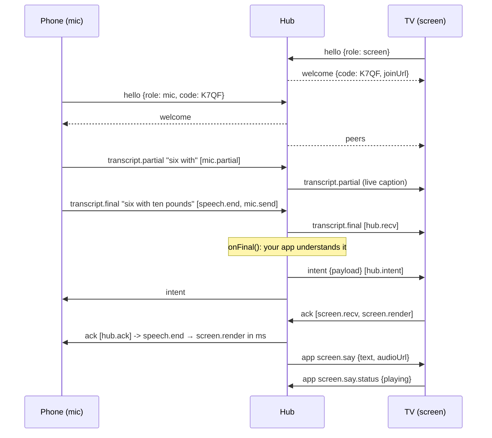

# tv-voice-bridge

**A voice back-and-forth for TV apps: the phone is the microphone, and the TV talks back.**

`tv-voice-bridge` is a small protocol plus a hub and a client. A TV app shows a 4-character pairing code; a phone joins it and streams what the user says; your app understands it and the TV answers, on screen and out loud. It is framework-agnostic: React Native for Vega, a web TV, React Native Web, Node.

```bash
npm install @rackboard/tv-voice-bridge    # not yet published; see "Development" for a local tarball
```

> The package name and scope are **placeholders** until the project is published. MIT licensed. Built for Rack Board, a Fire TV (Vega OS) home-gym coach, which is its first user.

## Why

Fire TV's **Vega OS gives third-party apps no microphone or speech-recognition API**, and most TVs ship no mic in the box. Voice on a TV app therefore needs a second device. Everyone in the room already has a phone with a good mic and a speech recognizer, so the phone is the mic. The hard parts are the plumbing:

- **pairing** a phone to *this* TV without accounts;
- **latency you can see**: where the time goes between "stopped talking" and "the TV changed";
- **the way back**: the TV saying something to the room (`screen.say`), with audio Vega's media player will actually play;
- doing it all over one WebSocket per device, so it runs on a LAN hub, on a laptop, or in the cloud.

The bridge does not ship an LLM or a speech engine. The phone's own recognizer produces text; your `onFinal` handler decides what it means.

## Quick start: a web TV and a phone (2 minutes)

```bash
npm install && npm run build                  # in this repo
node examples/minimal-web-tv/server.mjs       # TV: http://localhost:8800/   phone: the URL shown on the TV
```

Open the TV page on a screen, open the shown URL on a phone on the same Wi-Fi (or type in the box), and say something. The TV shows it and says "You said: …" back. The example is about 60 lines: [`examples/minimal-web-tv/server.mjs`](examples/minimal-web-tv/server.mjs), [`tv.html`](examples/minimal-web-tv/tv.html), [`../minimal-phone/phone.html`](examples/minimal-phone/phone.html).

Browser mic access needs a secure context: `localhost`, or https on the LAN (a local CA such as mkcert, trusted on the phone once).

## Quick start: React Native for Vega

See [`examples/minimal-vega/App.tsx`](examples/minimal-vega/App.tsx) for a whole screen in about 60 lines. It is illustrative: it is not type-checked here, because it needs a Vega project's dependencies. Installed from npm or a tarball, the package needs no Metro changes (Metro resolves `dist/` through `exports`). [`examples/minimal-vega/metro.config.js`](examples/minimal-vega/metro.config.js) is only for bundling the package from its TypeScript source, for example as a git submodule.

```tsx
const tv = new BridgeClient({ url: 'ws://127.0.0.1:8800/ws', role: 'screen' });
tv.on('welcome', (w) => setCode(w.code));                                  // show the code (and a QR of w.joinUrl)
tv.on('intent', (m) => { render(m.payload); requestAnimationFrame(() => tv.ack(m)); });
tv.onSay((line) => play(line.audioUrl) /* https only on Vega */ || caption(line.text, line.durationMs));
await tv.connect();
```

**Vega notes** (verified on the Vega Virtual Device, SDK 0.24):

- React Native's global `WebSocket` works. On the VVD, reach a hub on your machine with a **reverse port forward**, `vega device start-port-forwarding --port 8800 --forward false`, and connect to `ws://127.0.0.1:8800/ws`. The emulator's NAT alias `10.0.2.2` intermittently dropped WebSocket frames larger than about 1.4 KB in our tests. On a real stick, use the dev machine's LAN IP.
- The W3C media player (`@amazon-devices/react-native-w3cmedia`) **plays only publicly trusted https URLs**. It refuses `http://` and a local CA, and raw-mp3 MSE never initialized for us. For `screen.say` audio, upload the clip and send a presigned https URL (we use S3 with a 1 h expiry), or fall back to captions.
- Metro, only when bundling from source: the package source uses TS-ESM imports (`./protocol.js`). Map them to `.ts` in a custom `resolveRequest`, and re-apply the `react-native` → `@amazon-devices/react-native-kepler` mapping, because a custom resolver replaces Vega's. Without that mapping the bundle ships core React Native and the app aborts at launch.
- `performance.timeOrigin` may be missing on some runtimes; polyfill it as `Date.now() - performance.now()` so hop stamps stay in epoch ms.

## Hub (Node)

```ts
import http from 'node:http';
import { BridgeHub } from '@rackboard/tv-voice-bridge/hub';   // needs `ws`

const server = http.createServer(app);
const hub = new BridgeHub({
  server,                                   // or [httpServer, httpsServer]: one hub, several listeners
  path: '/ws',
  joinUrl: (code) => `https://${lanIp}:8443/p/${code}`,
  onFinal: async (room, msg) => {
    const understood = await myParser(msg.text);            // LLM, rules, both: your call
    hub.say(room, { id: nextId(), text: reply(understood), audioUrl: await tts(understood) });
    return { name: 'log_set', ok: true, payload: understood };   // fanned out as an `intent`
  },
  onApp: (room, msg) => null,               // taps, nav, state requests; return an intent to answer a tracked one
});
```

## Mic (phone)

```ts
import { BridgeClient, latency } from '@rackboard/tv-voice-bridge';
const phone = new BridgeClient({ url: `wss://${location.host}/ws`, role: 'mic', code });
await phone.connect();
recognition.onresult = (e) => { /* sendPartial(text, id) while speaking, sendFinal(text, { speechEndAt, utteranceId: id }) at the end */ };
phone.on('ack', (a) => show(latency(a.hops).span('speech.end', 'screen.render')));   // ms, across three devices
```

## Protocol v1

One JSON object per WebSocket frame. Roles: `screen` (the TV) and `mic` (a phone). All timestamps are **hub clock** in epoch ms; clients estimate their offset from `welcome.serverTime` and ping/pong (they keep the lowest-RTT sample).

| `type` | Direction | Fields | Notes |
|---|---|---|---|
| `hello` | client → hub | `v: 1`, `role`, `clientId`, `code?`, `name?` | A mic must send a live `code`. A screen may send one to resume its room after a reload |
| `welcome` | hub → client | `v`, `clientId`, `role`, `code`, `joinUrl?`, `peers[]`, `serverTime` | The screen shows `code` and a QR of `joinUrl` |
| `peers` | hub → room | `peers[]` | On every join and leave |
| `transcript.partial` | mic → hub → **screens** | `utteranceId`, `text`, `hops` | Live caption while the user is speaking |
| `transcript.final` | mic → hub → **screens** (+ `onFinal`) | `utteranceId`, `text`, `hops` | |
| `intent` | hub → **room** | `utteranceId`, `name`, `ok`, `payload`, `hops` | What the app understood. `payload` is app-defined |
| `ack` | screen → hub → **mics** | `utteranceId`, `stage: rendered\|error`, `detail?`, `hops` | Sent after the frame that shows the intent |
| `app` | any → hub | `topic`, `payload`, `utteranceId?`, `hops?` | App side channel. With `utteranceId` it is answered like an utterance |
| `ping` / `pong` | client ↔ hub | `t0`, `serverTime` | Clock sync |
| `error` | hub → client | `code: unknown-code\|bad-message\|version\|handler-failed`, `message`, `utteranceId?` | A frame before `hello` gets `bad-message` |

### Two-way: `screen.say` (TV → room)

The way back is an `app` message on topic **`screen.say`**, sent by the hub to the room's **screens only**:

```json
{"type":"app","topic":"screen.say","payload":{"id":"say_0007","text":"Logged. Rest two minutes.","audioUrl":"https://…/say_0007.mp3?X-Amz-…","durationMs":2400,"priority":"normal"}}
```

- The screen plays `audioUrl` if it can, otherwise speaks `text` with a local TTS (web), or shows the caption for `durationMs` (Vega without https audio).
- `priority: "high"` interrupts the current line and clears the queue; `"normal"` queues.
- Screens may report playback on **`screen.say.status`**: `{id, state: loading|playing|ended|interrupted|error|no-audio, detail?, at}`. That is how you learn the TV actually spoke (measured on the VVD with S3 audio: `loading` → `playing` in 166–224 ms).
- API: `hub.say(room, line, { topic? })`; on the screen, `client.onSay(fn, topic?)` (validated by `parseSay`) and `client.reportSay(status)`. Apps may use their own topic name with the same payload (for example `coach.say`).

### Sequence



### Latency hops

Every utterance carries `hops: [{hop, at}]`, appended in order and never reordered:

`speech.end → mic.send → hub.recv → hub.intent → screen.recv → screen.render → hub.ack`

(Taps use `input.end` instead of `speech.end`.) `latency(hops)` returns `legs`, `totalMs` and `span(from, to)`. Measured in the first app built on it:

| Path | Measured |
|---|---|
| Phone tap → Vega Virtual Device render (reverse port forward) | 6–69 ms (hub → screen 0–38 ms, render 5–27 ms) |
| Hub `screen.say` → audio playing on the VVD (S3 presigned mp3) | 166–224 ms after load; tap → audio start 378–391 ms |
| Web TV, same host | under 40 ms end to end |

## Security notes on pairing codes

- Codes are **4 characters from a 31-character alphabet** (no `0/O`, `1/I/L`): about 923,521 combinations. They are fine against guessing on a LAN; they are **not authentication**. Anyone who sees the TV can join. That is the point in a living room, and wrong for anything sensitive.
- A mic can only join a room that a screen created and that still exists. Unknown codes get `unknown-code`. Rooms live in memory and disappear when the hub restarts.
- If you expose the hub beyond the LAN: serve it over **https/wss**; add rate limiting on `hello` (the hub does none); expire codes (rotate per session); and consider a second factor such as an on-screen confirm.
- `clientId` is chosen by the client. A reconnect with the same id replaces the old socket, so treat it as a session handle, not an identity.
- `screen.say` audio URLs are bearer links. Use short-lived presigned URLs, not public buckets. Never log the query string.
- The hub runs no LLM and stores nothing. What `onFinal` does with transcripts is your app's privacy surface.

## Tests

`npm test` runs 40 tests:

- **Protocol conformance** (`test/conformance.test.ts`): wire vectors for every message type; malformed-frame rejection; the hub as a black box over raw sockets (refusal before `hello`, version, unknown code, code normalization, handler failure); the routing rules (who receives partials, finals, intents and acks); hop ordering; socket replacement on reconnect; and `screen.say` routing, topics, status reports and validation.
- **Client and hub behaviour** (`test/bridge.test.ts`): pairing, resume, the end-to-end hops, partials, taps and two mics.
- **Example smoke test** (`test/example.test.ts`).

A second implementation of the hub or client (another language or platform) should pass the conformance file.

## Development

Requires Node 20 or later (developed on Node 24).

```bash
npm install              # dev dependencies only; the package has no runtime dependencies (ws is an optional peer)
npm run typecheck        # tsc --noEmit over src/ and test/
npm test                 # vitest: 40 tests, no build needed (tests import src/)
npm run build            # tsc -> dist/ (ESM + .d.ts + source maps)
npm pack --dry-run       # lists dist/, src/, README.md, LICENSE (examples and tests are not packed)
```

`exports` point at `dist/`. A `source` condition points at `src/` so a monorepo or a git submodule can consume the TypeScript directly (`tsx -C source`, Vite `resolve.conditions`, TypeScript `customConditions`).

To try an unpublished build in another project, pack it and install the tarball:

```bash
npm pack --pack-destination ../my-app/vendor     # runs the build first (prepack)
cd ../my-app && npm install ./vendor/<tarball>.tgz
```

For a live link while you edit the bridge (changes show up without re-packing), use `npm link`:

```bash
npm run build && npm link                         # in this repo
cd ../my-app && npm link @rackboard/tv-voice-bridge
```

A linked package is a symlink outside the app's folder, so React Native for Vega's Metro bundler may not follow it without extra `watchFolders` config. Prefer the tarball for Vega builds and for anything a fresh clone must install.

Not yet published: the name and scope are pending, and `package.json` is marked `"private": true` so it can't be published by accident.

### Contributing

Keep the wire protocol backwards compatible within v1, and add a vector to `test/conformance.test.ts` for any new message, topic or routing rule. Run `npm run typecheck && npm test` before sending a change.

## License

MIT © 2026 Kaung Zin Hein
