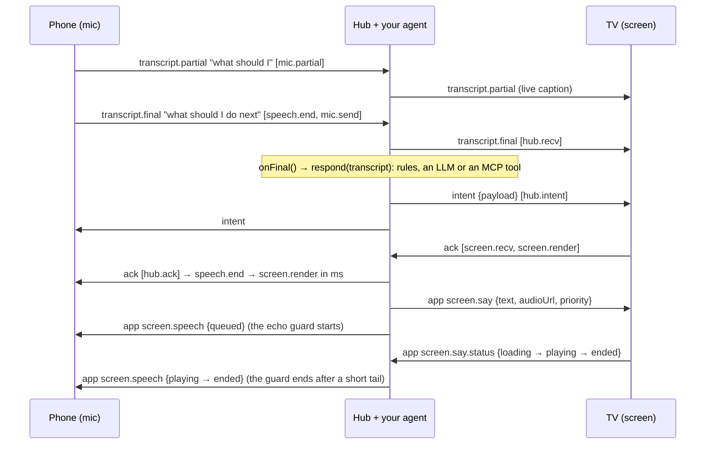

# tv-voice-bridge

[](https://github.com/Zen-cronic/tv-voice-bridge/actions/workflows/ci.yml)

**Two-way voice for Fire TV (Vega) apps and AI agents: the phone listens, your agent answers, the TV shows it and says it. Echo guard, barge-in, every hop timed. No phone app.**

**Measured on the Vega Virtual Device.** Version 0.3.5 has also run on a Fire TV Stick inside Spee, my speaking coach on Bee, whose Fire TV app pairs with its phone page through the bridge. That stick run was not measured.


*The [Vega voice loop example](examples/vega-voice-loop) on the Vega Virtual Device. The metrics rows are replies that have finished playing, so in this capture the row for "what time is it" had not landed yet. Since 0.4.0 the TV shows the current utterance as a pending row until its reply ends.*

**Where things run:** the hub on a laptop, a LAN box or a container (Node 20+) · the TV app (React Native for Vega, or a web page) · the phone's browser (Web Speech; nothing to install). **Proof:** tests on Node 20, 22 and 24 in CI · the Vega example type-checked against the real React Native for Vega packages · a written wire protocol (v1) with conformance tests · MIT.

```
phone speech  →  your app or agent  →  TV renders  →  TV speaks (screen.say)  →  playback confirmed
```

The phone's own recognizer turns speech into text. Your `onFinal` handler, whether rules, an LLM or an MCP client, decides what it means and what the TV should say. The bridge carries the text both ways, confirms that the TV rendered and played the result, and keeps the TV's own voice from coming back through the phone's microphone. Pairing is the smallest part: the TV shows a 4-character code and a QR code, and the phone joins with it.

| Import | What it is |
|---|---|
| `tv-voice-bridge` | The framework-agnostic client for both roles (React Native for Vega, web TVs, Node), plus the protocol types |
| `…/react` | `useVoiceBridge()` and `<PairingQr>` for the TV, with no native dependencies |
| `…/vega` | `createVegaSayPlayer()`: the TV speaks back on Vega OS, from a plain-http hub ([below](#the-tv-speaks-back-on-vega-vega)) |
| `…/phone` | The voice half for a phone browser page: Web Speech in, transcripts out, the [echo guard](#the-echo-guard) and barge-in |
| `…/hub` | The Node hub, and the `tv-voice-bridge-hub` CLI |
| `…/serve` | `servePhonePage()` and `lanAddress()`: the shipped phone page, from your own server |
| `…/qr` | A dependency-free QR Code encoder for the pairing screen |
| [PROTOCOL.md](PROTOCOL.md) | The wire protocol (v1), for a second implementation on another platform |

Version **0.4.0**, protocol v1 revision 3 ([CHANGELOG.md](CHANGELOG.md)). Not on npm: [install](#install) it from git or a release tarball.

## The whole loop in one command

```bash
npm install && npm run example
```

[`examples/loop/loop.mjs`](examples/loop/loop.mjs) runs a hub, a TV and a phone in one process, with no device and no keys. The phone's recognizer is scripted and the TV has no speaker; everything else is the library's own code. For each utterance it prints the hop timeline. While the TV "talks", the phone also hears the reply, as a phone in the same room would, and the echo guard drops it. The output looks like this (in-process on one machine, so the network legs are near zero):

```
"what should I do next"  ->  TV says "Next up: three sets of squats."
  mic.send -> hub.recv              0 ms
  hub.recv -> hub.intent            0 ms
  hub.intent -> screen.recv         0 ms
  screen.recv -> screen.render      0 ms
  speech.end -> screen.render       2 ms   (heard -> on screen)
  say -> playing                    1 ms   (reply dispatched -> TV reports sound)
...
echo guard: 3 of 3 replies heard by the phone were dropped; the TV received 3 transcripts, all from the user
```

## Why

Fire TV's Vega OS has **no app-level speech-to-text API**. Amazon's developer forum says so in two threads: [Speech-to-Text API for a WebView app](https://community.amazondeveloper.com/t/speech-to-text-api-for-a-webview-app/29064) and [Speech-to-text support with manual mic trigger](https://community.amazondeveloper.com/t/speech-to-text-support-with-manual-mic-trigger/27863). What a Vega app gets instead is limited:

- **Keyboard dictation.** The only platform speech-to-text is the system keyboard's one-shot dictation into a focused text field.
- **No WebView mic.** WebView microphone access (`getUserMedia` audio) is not supported for third-party apps ([forum](https://community.amazondeveloper.com/t/issues-with-microphone-access-for-jitsi-integration-on-vega-os/28161)).
- **A privileged raw-audio API.** [`AudioRecordStream`](https://developer.amazon.com/docs/vega-api/0.24/classes.AudioRecordStreamBuilder.amazon-devices_keplerscript-audio-lib.html) sits behind the `com.amazon.audio.privilege.microphone.access` privilege with a run-time grant. It returns raw PCM with no recognizer, so you would ship your own speech-to-text. We have not tested which microphone it reaches on a Fire TV Stick.
- **No app-level text-to-speech either.** VoiceView, the screen reader, is the only platform speech output ([forum](https://community.amazondeveloper.com/t/tts-implementation/24875)).

So a TV app that wants a conversation needs speech-to-text somewhere else, and a way to talk back. Everyone in the room already has a phone with a good mic and a recognizer, so the phone listens. The hard parts are the plumbing:

- getting the words to *this* TV;
- getting an answer back out loud, in audio Vega's media player will actually play;
- keeping the TV's voice out of the phone's mic;
- seeing where the time goes;
- staying connected through TV-runtime quirks and hub restarts.

[docs/vega-notes.md](docs/vega-notes.md) records each Vega quirk we hit and what the bridge does about it.

## Why not…

- **Alexa or Alexa+?** Apart from keyboard dictation, Alexa reaches a Vega app as structured requests: [Content Launcher](https://community.amazondeveloper.com/t/migrating-catalog-and-voice-integration-from-fire-os-to-vega/4341) (launch or search content), media controls (play, pause) and UI-controller selection ([forum](https://community.amazondeveloper.com/t/is-it-posible-to-create-custom-voice-commands-on-vega/27800)). None of them gives the app the user's own words, and none lets the app answer in its own voice. The bridge is the free-form conversation inside your app: your agent hears every word and the TV answers out loud. The two fit together: Alexa launches your app, and the bridge talks inside it. There is no wake word: the user holds the phone's button, or turns on hands-free.
- **Keyboard dictation?** It suits a search box. The user holds the remote's mic button and one final string lands in a focused `TextInput`. There are no partials, the app cannot start listening on its own, and there is no way back (the TV saying something) and no timing. A conversation needs every one of those.
- **[Matter Casting](https://developer.amazon.com/docs/vega/0.24/vega-matter-casting-integration.html)?** It is the official phone-to-Vega companion path. It covers launching content, media playback controls and switching between an app's targets, and it carries no free-form app messages, audio or speech. Use Matter to launch your app, and the bridge to talk to it.
- **A bare socket library?** Generic WebSocket rooms give you transport. You would still build all of the following:
  - roles and pairing codes, with guess limits;
  - transcript, intent and ack semantics;
  - a speech back-channel with playback status, and the echo guard;
  - hop timing with clock sync;
  - reconnect and dead-link detection for TV runtimes;
  - a conformance suite so a second platform can join.

  That is this package.

## Browsers

The phone side is a web page, so voice depends on the phone's browser. Every browser can type instead.

| Browser | Voice | Notes |
|---|---|---|
| Chrome on Android | Yes, over https | Or over plain http with Chrome's per-device developer flag ([docs/https.md](docs/https.md#1-chrome-on-your-own-android-phone-the-developer-flag)) |
| Safari 26 and later (iPhone, iPad, Mac) | Yes, over https only | Siri must be on. On a plain-http page Safari has no recognizer at all |
| Other browsers on iPhone | Not verified | Reported to have no speech recognition; open the page in Safari |
| Chrome or Safari on a desktop | Yes, over https or `localhost` | `http://localhost:<port>/p/<code>` on the hub's own computer works with no certificate |
| Brave | Desktop: no | Brave turns recognition results off ([issue](https://github.com/brave/brave-browser/issues/2802)); mobile not verified |
| Firefox | No | No speech recognition |

The phone page checks this itself (`voiceSupport()` in `./phone`): over plain http it says why voice is off, lists the fixes with the page's own address filled in, and keeps typing. [docs/https.md](docs/https.md) has the four ways to get https: Chrome's developer flag, a tunnel, a local certificate authority for an iPhone, and `localhost`.

## Where speech is recognized

The phone sends the hub text, never audio. The recognition happens in the phone's browser, with that browser's speech service:

- **Safari:** Apple's speech recognition, the service behind Siri and dictation (Siri must be on).
- **Chrome on Android:** Google's speech servers.
- **Chrome on a desktop:** Google's servers by default. Since Chrome 139 a page can ask for on-device recognition ([`processLocally`](https://chromestatus.com/feature/6090916291674112)); `./phone` does not ask for it yet.

What the hub and your `onFinal` do with the text is your app's privacy surface. The hub stores nothing ([SECURITY.md](SECURITY.md)).

## Install

```bash
npm install github:Zen-cronic/tv-voice-bridge          # builds dist/ on install (the prepare script)
npm install github:Zen-cronic/tv-voice-bridge#v0.4.0   # a release tag
```

Each [GitHub release](https://github.com/Zen-cronic/tv-voice-bridge/releases) also carries the packed tarball. Or pack it yourself:

```bash
npm pack --pack-destination ../my-app/vendor     # in this repo; builds first
cd ../my-app && npm install ./vendor/tv-voice-bridge-0.4.0.tgz
```

Prefer a tarball for Vega builds: Metro may not follow the symlink that `npm link` or a git checkout makes. The hub needs `ws` (an optional peer dependency); the client needs nothing. `./react` needs `react` 18 or later and a `react-native` your bundler resolves (React Native for Vega, or react-native-web); both are optional peer dependencies that only `./react` imports. `./vega` needs `@amazon-devices/react-native-w3cmedia` (optional too).

## Quick start: an agent on a web TV (2 minutes)

```bash
npm install && npm run build
node examples/agent/agent.mjs        # port 8800. TV: http://localhost:8800/   phone: scan the TV's QR
```

Open the TV page on a screen and scan its QR with a phone on the same Wi-Fi, then type, or talk once the page is on https or `localhost` ([Browsers](#browsers)). The TV shows what you said and speaks the agent's reply. [`examples/agent/agent.mjs`](examples/agent/agent.mjs) is about 40 lines, and `respond(transcript)` is the only part you replace:

```js
// LLM:  respond = async (t) => (await llm.chat({ messages: [...history, { role: 'user', content: t }] })).text
// MCP:  respond = async (t) => (await mcp.callTool({ name: 'answer', arguments: { question: t } })).content[0].text
startAgent({ respond, timeoutMs: 8000, fallback: "Sorry, I didn't catch that." });
```

`respond` is time-boxed and may throw; the TV always answers. The default responder is offline and deterministic, and `test/agent.test.ts` walks the whole round trip with a stub. [`examples/minimal-web-tv/server.mjs`](examples/minimal-web-tv/server.mjs) is the plain echo version.

## Quick start: a Fire TV (Vega) app

The TV half is a hook, a QR and a player:

```tsx
import { useMemo } from 'react';
import { PairingQr, useVoiceBridge } from 'tv-voice-bridge/react';
import { createVegaSayPlayer } from 'tv-voice-bridge/vega';

const HUB = '127.0.0.1:8790';   // node examples/vega-voice-loop/hub.mjs (a reverse port forward on the VVD)

export function App() {
  const player = useMemo(() => createVegaSayPlayer({ baseUrl: `http://${HUB}` }), []);
  const tv = useVoiceBridge({ url: `ws://${HUB}/ws`, player });   // acks each intent after the frame that shows it
  if (tv.status !== 'paired') return <PairingQr value={tv.joinUrl ?? ''} size={200} />;   // plus tv.code as text
  return <Answer heard={tv.final?.text} live={tv.partial} reply={tv.intent?.payload} saying={tv.saying?.state} />;   // your view
}
```

- [`examples/minimal-vega/App.tsx`](examples/minimal-vega/App.tsx) is a whole screen in about 40 lines, for a `vega project generate` app.
- [`examples/vega-voice-loop`](examples/vega-voice-loop) is the built, measured version: a Vega app, a hub with local text-to-speech on port 8790, your agent through `RESPOND_CMD`, and a scripted phone. Its hub serves the fragmented MP4 clips `./vega` plays over plain http; the web-TV agent on 8800 serves text only, so a Vega app pointed there shows captions and reports "no audioUrl".
- Installed from a tarball, the package needs no Metro changes: Metro resolves `dist/` through the package's `exports` (React Native 0.83 for Vega; for 0.72, see below).

**Vega notes** (verified on the Vega Virtual Device, SDK 0.24; the full list is [docs/vega-notes.md](docs/vega-notes.md)):

- **WebSocket and the VVD.** React Native's global `WebSocket` works. On the VVD, reach a hub on your machine with a **reverse port forward**, `vega device start-port-forwarding -d VirtualDevice --port 8790 --forward false`, and connect to `ws://127.0.0.1:8790/ws`. The emulator's NAT alias `10.0.2.2` dropped WebSocket frames larger than about 1.4 KB in our tests. On a stick, the same reverse forward works over Wi-Fi, or use the dev machine's LAN address.
- **Built-in client defences.** The client reassembles messages that arrive split across events, and its heartbeat drops a link that goes silent even when `onclose` never fires.
- **Audio: https in URL mode, or fragmented MP4/AAC over plain http.** The W3C media player (`@amazon-devices/react-native-w3cmedia`) plays an `https://` URL only with a publicly trusted certificate (a local CA is refused). Over `http://` it plays only through Media Source Extensions, and only fragmented MP4 with AAC: raw MP3 through MSE never starts. `./vega` handles both; see [below](#the-tv-speaks-back-on-vega-vega).
- **Metro, only when bundling from source.** The package source uses TS-ESM imports (`./protocol.js`), so map them to `.ts` in a custom `resolveRequest`. A custom resolver replaces Vega's own, so also re-apply the `react-native` → `@amazon-devices/react-native-kepler` mapping; without it the bundle ships core React Native and the app aborts at launch. See [`examples/minimal-vega/metro.config.js`](examples/minimal-vega/metro.config.js).
- **React Native 0.72 Vega apps (Metro before 0.82).** The subpaths (`tv-voice-bridge/react`, `/vega`, `/qr`) resolve through the package's `exports`, which Metro reads by default only from 0.82 (React Native 0.83 for Vega). On the 0.72 line, turn it on in `metro.config.js`: `mergeConfig(getDefaultConfig(__dirname), { resolver: { unstable_enablePackageExports: true } })`. That switch applies to every package the app bundles, so rebuild and launch once after setting it. This repo's Vega example and its CI typecheck use React Native 0.83; the 0.72 setting is not tested here.
- **`performance.timeOrigin`.** It may be missing on some runtimes. The client falls back on its own; polyfill it as `Date.now() - performance.now()` if your code stamps `receivedAt` itself.

## The React hook (`./react`)

`useVoiceBridge()` wraps the client for a React or React Native TV. It runs on React Native for Vega and react-native-web, and `<PairingQr>` draws the QR code with plain `View`s.

```tsx
const tv = useVoiceBridge({
  url: 'ws://192.168.1.20:8790/ws',
  player: (line, ctl) => {                          // play line.audioUrl, or a local TTS of line.text
    const stop = myPlayer.play(line, { onStart: ctl.playing, onEnd: ctl.ended, onError: ctl.error });
    return stop;                                    // called when a high-priority line or a barge-in interrupts
  },
  onIntent: (m) => applyToMyState(m.payload),        // the ack is sent after the frame that shows it
});
```

- **What it returns:**
  - `status`: `connecting`, `waiting-for-phone`, `paired`, `reconnecting` or `closed`;
  - `code`, `joinUrl`, `peers` and `mics`;
  - the live `partial`, and the latest `final` and `intent`;
  - `saying`, the line being said and its state;
  - `say(text)`, `stopSay()`, `sendApp()` and `ack()`, plus `client` for anything else.
- **Acks follow the paint.** The hook acks each intent in a task queued from the next animation frame after React commits it. So the `screen.render` hop is a moment when the viewer could see the result. Pass `autoAck: false` to ack yourself.
- **Say lines play one at a time** through your `player`. Lines come from the hub, or from the TV's own `say(text)`. `high` priority interrupts the current line, and so does a phone's barge-in (`interruptible`, default true). Every state is reported on `screen.say.status`, with the line's text, which is what keeps the phone's echo guard in step. With no player, lines are captions only and are reported as `no-audio`.
- **Callbacks and the player are read from the latest render,** so inline functions are fine. The connection is rebuilt only when `url`, `code`, `name`, `clientId`, `resumeToken`, `sayTopic` or `enabled` change. Unmounting closes it.
- **`<PairingQr value size? ecc? quietZone? dark? light? testID? />`** draws one `View` per horizontal run of dark modules over a light square. The square includes the 4-module quiet zone and uses whole-number cells. Its default `testID` is `pairing-qr`.
- **Where it has run.** The Vega voice-loop example runs on the hook on the VVD (measured below). Spee, which uses `BridgeClient` and `PairingQr` from version 0.3.5, ran on a Fire TV Stick on 2026-10-20; that run was not measured. The tests use react-test-renderer and React 18 with a host-component mock of `react-native`.

## The TV speaks back on Vega (`./vega`)

`createVegaSayPlayer()` is a `SayPlayer` for `useVoiceBridge` built on Vega's W3C media player:

- **https** (publicly trusted) plays in URL mode.
- **Plain http** plays through Media Source Extensions, as **fragmented MP4 with AAC**. That is what lets a hub on a laptop or the LAN speak its own text-to-speech with no certificate or cloud storage. A raw MP3 over http is refused with a message rather than the player's opaque `MediaError 3`: Vega's MSE demuxer never starts on raw MP3, though `isTypeSupported('audio/mpeg')` says yes.
- The player plays first and ends the stream only once the demuxer has it (`loadedmetadata`, `canplay` or `playing`). Ending it earlier fails, and a short clip may not start until the stream is ended.
- Each line reports `loading`, `playing` (when sound starts), then `ended`, `interrupted` or `error` on `screen.say.status`, so the hub can time it and the phone's echo guard knows when the TV is audible.
- Encode clips with ffmpeg: `-c:a aac -movflags +frag_keyframe+empty_moov+default_base_moof -f mp4`. [`examples/vega-voice-loop/tts.mjs`](examples/vega-voice-loop/tts.mjs) does it from macOS `say`, Linux `espeak`, Amazon Polly or any command (`TTS_CMD`).

[`examples/vega-voice-loop`](examples/vega-voice-loop) is the whole loop as a Vega app: the pairing QR, the phone's words as they arrive, the answer, the answer said out loud, and the hub's measurements of each loop, shown on the TV. The screenshot at the top of this page is that app.

| Leg (hub clock) | Vega Virtual Device (SDK 0.24), scripted phone, 4 utterances | Fire TV Stick, real phone |
|---|---|---|
| speech end → answer on screen | 11–46 ms | *not measured yet* |
| `screen.say` → audio playing | 72–175 ms | *not measured yet* |
| **speech end → reply audible** | **217–322 ms** | *not measured yet* |
| replies played to the end | 4 of 4 | *not measured yet* |

<!-- The right-hand column is filled only from bench-phone.json after a measured stick run (scripts/stick-run.md), never by hand. test/docs.test.ts fails if a number appears there before then. -->

The scripted phone stamps `speech.end` when it sends the final, so a real phone's recognizer tail comes on top. Text-to-speech (espeak, about 140 ms) runs while the answer is already on screen. Measured earlier in the first app built on the bridge, on the VVD: phone tap → TV render 6–69 ms over a reverse port forward, and `screen.say` → audio playing from a presigned S3 MP3 166–224 ms. A web TV on the same host is under 40 ms end to end.

## The round trip



Every utterance carries `hops: [{hop, at}]` in **hub clock**. Each client estimates its offset to the hub from `welcome` and ping/pong samples, keeping the lowest-RTT one. Hops are appended in order and never reordered:

| Leg | What it measures |
|---|---|
| `speech.end → mic.send` | The phone recognizer's tail: from silence to a final result |
| `mic.send → hub.recv` | Phone to hub network |
| `hub.recv → hub.intent` | **Your app or agent** (`onFinal`) |
| `hub.intent → screen.recv` | Hub to TV network |
| `screen.recv → screen.render` | The TV drawing the result (stamped after the frame that shows it) |
| `screen.render → hub.ack` | TV to hub (the confirmation, not user-visible) |
| `screen.say` sent → `screen.say.status: playing` | The TV loading and starting the reply's audio (`at` is hub clock) |

`latency(ack.hops).span('speech.end', 'screen.render')` gives the user-visible number, and `.legs` gives each leg. Taps use `input.end` instead of `speech.end`. `./phone` also stamps `speech.start`, so `speech.start → speech.end` is how long the user spoke.

## Hub (Node)

```ts
import http from 'node:http';
import { BridgeHub } from 'tv-voice-bridge/hub';   // needs `ws`

const server = http.createServer(app);
const hub = new BridgeHub({
  server,                                   // or [httpServer, httpsServer]: one hub, several listeners
  joinUrl: (code) => `https://${lanIp}:8443/p/${code}`,
  onFinal: async (room, msg) => {
    const reply = await respond(msg.text);                     // rules, an LLM, an MCP tool: your call
    hub.say(room, { id: nextId(), text: reply, audioUrl: await tts(reply), priority: 'high' });
    return { name: 'reply', ok: true, payload: { text: msg.text, reply } };   // fanned out as an `intent`
  },
  onApp: (room, msg) => null,               // taps, nav, playback status; return an intent to answer a tracked one
});
```

The hub is defensive by construction. No frame, upgrade request or app callback can throw out of it. Every field of every message is validated, and anything bad gets a typed error instead of a crash. A handler that throws gives the room `handler-failed` with the generic message "handler failed"; the exception text goes to the hub's log.

The CLI is the same hub with a phone page. In a clone of this repo, run `npm run hub -- --port 8790` (add `--echo` to answer each final with "You said: …"). In an app that installed the package, run `npx --no-install tv-voice-bridge-hub --port 8790`. The command is this package's bin, and `--no-install` stops npx from downloading some other npm package that happens to have that name. Either way, it prints the WebSocket URL and the join URL built from this machine's LAN address. [docs/deploy.md](docs/deploy.md) has the rest: every hub option and limit, containers, reverse proxies and tunnels (`--trust-proxy` and `X-Forwarded-For`), the Origin check, serving the phone page from your own server, and what `hub.stats` and the log report.

## Phone (`./phone`)

The phone is a web page; nothing is installed on it. [`examples/minimal-phone/phone.html`](examples/minimal-phone/phone.html) is a complete one, with hold-to-talk, hands-free, a stop button, typed input, a code entry when opened without a code, and an explanation when voice cannot work on that page.

```ts
import { latency } from 'tv-voice-bridge';
import { connectPhone, createPhoneMic, voiceSupport } from 'tv-voice-bridge/phone';

const voice = voiceSupport();                       // { ok, reason?, message, fixes[] }: show it when !voice.ok
const phone = connectPhone();                       // hub URL and code from this page's address (/p/K7QF)
phone.on('ack', (a) => show(latency(a.hops).span('speech.end', 'screen.render')));   // ms, across three devices
phone.on('repair', () => askToScanAgain());         // the TV's room is gone for good

const mic = createPhoneMic({ client: phone, mode: 'push-to-talk', echoGuard: { bargeIn: true } });
button.onpointerdown = () => mic.start();
button.onpointerup = () => mic.stop();              // the final result still arrives
mic.on('error', (e) => show(e.message));            // e.code: no-support, insecure-context, permission-denied, ...
```

- **Recognizer.** It uses Web Speech (`SpeechRecognition`, or Safari's `webkitSpeechRecognition`). Pass `recognizer` to use something else with the same shape, as the tests do.
- **Transcripts.** Interim results become `transcript.partial`s, at most one per `partialEveryMs` (150 ms) and always ending on the latest text. Finals become `transcript.final`s with `speech.start` and `speech.end` hops. `speech.end` is the recognizer's `speechend` event when it fired for this utterance; otherwise it is the last time the interim text changed. That is the closest a browser recognizer gets to "the user stopped talking".
- **Modes.** `push-to-talk` is `start()` on press and `stop()` on release. `continuous` listens until `stop()`, and restarts each session the browser ends; iOS Safari ends them often. The restart delay backs off while sessions keep ending quickly.
- **Errors.** Each error has a code and a plain message. `no-support`, `insecure-context` (speech recognition needs https or `localhost`), `permission-denied` and `no-microphone` are fatal. `no-speech` and `network` are not. Typed input over plain http still works.
- **`voiceSupport()`** answers before the user presses anything: whether this page can listen, and if not, why (`insecure-context`, `no-support`) and what to do, with the page's own address filled in. Browsers with no recognizer are told which one to use.
- **Without `./phone`,** drive `BridgeClient` yourself: `new BridgeClient({ url, role: 'mic', code })`, `sendPartial(text, id)` while speaking, and `sendFinal(text, { speechEndAt: localNow(), utteranceId: id })` at the end.

## The echo guard

The phone's microphone and the TV's speaker are in the same room. A phone that keeps listening hears the TV's reply, and without a guard it would send the TV's words back as the user's next utterance. Then the agent answers itself.

The hub tells each phone what the TV is saying, on `screen.speech`. It sends `queued` when your app sends a say line, then relays each playback report the TV sends (`loading`, `playing`, `ended`, `interrupted`, `error`, `no-audio`). The notices never carry the audio URL. `createPhoneMic` uses them like this:

- **Drop while the TV is audible.** From `queued` until `ended`, `interrupted` or `error`, plus a short tail (`tailMs`, 700 ms), whatever the mic hears is dropped, and it reports `dropped` with reason `echo`. `mode: 'pause'` aborts the recognizer instead and restarts it after the line, in continuous mode. A `no-audio` (captions only) line releases at once.
- **Never stuck.** A screen that never reports holds the guard only for the line's `durationMs` plus slack. Every hold is capped at `maxHoldMs` (20 s).
- **Late echoes.** A final that repeats the TV's last words a few seconds after a line is dropped too (reason `echo-text`). It needs at least three words that are mostly the line's, or the whole line, so a short "yes" gets through.
- **Barge-in** (`bargeIn: true`). The user talks over the TV: speech during a line that has at least two words and is mostly not the line's own words. The phone then sends `screen.say.stop`, and the TV stops and drops its queue. What the user said is kept. In push-to-talk, pressing the button while the TV talks is itself a barge-in, and `mic.interrupt()` is a stop button. Automatic barge-in needs the line's text, so it is off for lines a screen reports without `text`.

The TV side honours `screen.say.stop` in `useVoiceBridge` (default) and in the example web TV, and both report every line they drop. Mixed versions work. A 0.2 hub sends no notices, so a 0.3 or later phone's guard never engages. A 0.2 screen ignores stops, but its playback reports still drive the guard. The wire details are in [PROTOCOL.md](PROTOCOL.md#101-the-echo-guard-screenspeech-and-screensaystop-revision-3).

## Pairing QR (`./qr`)

The pairing screen shows the join URL as a QR code. `./qr` encodes it with no dependencies, so a TV app does not need a native QR module or an SVG renderer.

```ts
import { qrMatrix, qrRuns, qrSvg, qrSvgPath } from 'tv-voice-bridge/qr';

const m = qrMatrix(joinUrl);                  // { size, version, ecc: 'M', mask, modules: boolean[][] }, no quiet zone
const d = qrSvgPath(m, { cell: 8, margin: 4 });   // one SVG path, dark modules merged into horizontal runs
const svg = qrSvg(m);                         // a whole <svg> document with a 4-module quiet zone
const runs = qrRuns(m);                       // [{x, y, w}], for any other renderer (PairingQr uses these)
```

- **What it encodes:** byte mode (UTF-8; `eci: true` adds an ECI 26 header), error correction `L`, `M` (default), `Q` or `H`, and versions 1 to 40. It picks the smallest version that fits, and the mask with the lowest penalty under the four rules of ISO/IEC 18004. It was written from the standard.
- **How it is tested:** `test/qr.test.ts` rasterizes symbols and reads them back with an independent decoder (a devDependency). Every version at every level is filled to its last byte and decoded, except version 23 at level L. There the decoder's own alignment table differs from the spec's, so that pair is checked structurally instead. The test also covers each mask, UTF-8 with and without ECI, and each copy of the format and version information on its own.

## Staying connected

With `reconnect` on (the default), the client keeps the link up until `close()`:

- **Backoff:** capped exponential, 250 ms doubling to 10 s, with half of each delay random.
- **Dead links:** the heartbeat pings every 10 s and drops the link after 25 s of silence.
- **Hub restarts:** a phone that gets back before the TV keeps retrying `unknown-code` while the TV re-creates its room with the same code. After `repairAfterMs` (60 s) it stops with status `repair`.
- **Fatal answers:** `version`, `id-in-use`, and a wrong code on a first pairing stop the client.

To keep a `clientId` across page reloads, persist **both** `client.clientId` and `client.resumeToken` and pass them back in. The token proves that the new connection owns the id, and lets it back into its room even while the hub has paused pairing. Never display or log the token.

## Protocol

[PROTOCOL.md](PROTOCOL.md) is the spec, with portable wire vectors in [`test/vectors/wire.json`](test/vectors/wire.json) and a black-box suite any hub can run (`TVB_HUB_URL=ws://host:port/ws npm run conformance`). It covers framing, every message with field limits, who may send what, routing, pairing and room lifetime, identity, liveness, errors, hub-clock hops, `screen.say`, the echo guard relays, backpressure, and the versioning rules. Version `1` has three revisions, which interoperate both ways. In short:

| `type` | Direction | Notes |
|---|---|---|
| `hello` / `welcome` / `peers` | client ↔ hub | A mic sends a live `code`; a screen may send one to resume its room |
| `transcript.partial` / `transcript.final` | mic → hub → **screens** (+ `onFinal`) | Live caption, then the final text |
| `intent` | hub → **room** | What your app or agent understood |
| `ack` | screen → hub → **mics** | Sent after the frame that shows the intent |
| `app` | any → hub | Side channel. `screen.say` (hub → screens) and `screen.say.status` (screen → hub) ride on it |
| `app` `screen.speech` | hub → **mics** | What the TV is saying, for the echo guard. Never carries the audio URL |
| `app` `screen.say.stop` | mic → hub → **screens** | Stop talking (barge-in, or a stop button) |
| `ping` / `pong` | client ↔ hub | Clock sync and liveness |
| `error` | hub → client | `unknown-code`, `bad-message`, `version`, `handler-failed`, `rate-limited`, `id-in-use`, `full`, `not-allowed` |

## Security

A pairing code is 4 characters from a 31-character alphabet (923,521 codes). Anyone who can see the TV can join, which is the point in a living room and wrong for anything sensitive. What the hub does about the rest:

- **Guessing is throttled,** per client address (30 wrong codes a minute; an IPv6 client counts as its /64) and across the whole hub (100 per 10 minutes, after which pairing pauses for every code, the right one too, so a refusal tells a guesser nothing). Peers already paired, and peers resuming with their token, stay in.
- **Pages on other sites cannot connect** to the CLI hub or the Vega voice loop's hub: they check `Origin`, and `BridgeHub` offers the same check as `allowedOrigins`.
- **Rooms do not outlive the TV,** errors do not carry exception text, `screen.speech` never carries audio URLs, a `clientId` can be taken over only with its `resumeToken`, and the hub answers only with WebSocket subprotocols it was told it may select.
- **Serve https/wss beyond your own LAN.** Over plain ws, transcripts are readable on the network.

[SECURITY.md](SECURITY.md) has the threat table, what is not covered (no end-to-end encryption, no PAKE), and how to report a vulnerability.

## Known limits

- **The Fire TV Stick is not measured yet.** Every Vega number here is from the Vega Virtual Device. Version 0.3.5 has run on a stick inside Spee, with no measurements. [scripts/stick-run.md](scripts/stick-run.md) is the measured run, step by step.
- **Plain-http audio in URL mode, after Amazon's September 2026 OS update,** and **what happens when Alexa backgrounds the app,** are untested; both are steps of the stick run. The client's heartbeat and reconnect should recover a suspended connection.
- **`AudioRecordStream` is untested.** We have not tested which microphone it reaches on a stick (see Why).
- **No end-to-end encryption.** Transport security is TLS between each device and the hub.
- **One hub process holds all rooms in memory.** There is no clustering.
- **The echo guard is a heuristic.** It trusts the TV's playback reports, and it holds for a capped time when there are none. Barge-in and late-echo detection compare words with the TV's line, so a recognizer that badly mishears the TV can fool them. Room acoustics are not modelled.
- **`./phone` relies on the browser's recognizer** ([Browsers](#browsers)), and its timing events vary by engine, so `speech.end` is an estimate.
- **`./react` is tested under React 18** with react-test-renderer and a host-component mock of `react-native`; the Vega example uses React 19.2 and type-checks in CI.
- **The Dockerfile's steps were rehearsed outside a container** (install, build, pack, install the tarball, start the CLI). The image itself has not been built in this repo.

## Tests

`npm test` runs every suite with vitest, offline (no device, network or keys), and CI runs it on Node 20, 22 and 24 on every push.

- **Hub conformance, against any hub** (`test/hub-conformance.test.ts`): the black-box cases a second hub must pass, over raw WebSockets. `npm test` runs them against this repo's CLI hub; `TVB_HUB_URL=ws://host:port/ws npm run conformance` runs them against any running hub, and CI runs them against a separate hub process. The wire vectors are plain JSON in `test/vectors/wire.json`.
- **Protocol conformance** (`test/conformance.test.ts`), the reference for second implementations: wire vectors for every message type; field-level validation; the hub as a black box over raw sockets (refusals, version, pairing, code normalization, `id-in-use`, 0.1 compatibility, role rules, handler failure); routing, hop order and `screen.say`; the echo guard relays.
- **Hub robustness** (`test/robustness.test.ts`): every input that crashed the 0.1.0 hub (non-string `code`, invalid UTF-8, a reserved opcode, an oversized frame, a bad upgrade target, throwing callbacks), room lifetime, collision-free codes, brute-force limits per key and hub-wide (and resuming through a pause), IPv6 /64 keys, the Origin allow-list, generic `handler-failed`, capacity, dead-holder takeover, heartbeat and backpressure.
- **Client resilience** (`test/client.test.ts`): backoff, split-frame reassembly, dead links without `onclose`, connect timeout, timer hygiene, clock-offset reset, and real hub restarts (re-join and re-pair).
- **Client and hub behaviour** (`test/bridge.test.ts`): pairing, resume, end-to-end hops, partials, taps, two mics.
- **Phone** (`test/phone.test.ts`), with a scripted recognizer and a real hub: pairing from the page address, throttled partials, `speech.start` / `speech.end`, continuous restarts, typed errors, the echo guard, late echoes, pause mode, barge-in, the guard's clock, and `voiceSupport()` per browser.
- **React** (`test/react.test.ts`), with react-test-renderer and a real hub: status transitions, ack-after-render hops, the say queue and its reports, interrupts, callback refs, cleanup, barge-in through `./phone`, and PairingQr's views reproducing and decoding to the matrix.
- **QR** (`test/qr.test.ts`): decode round trips (see [Pairing QR](#pairing-qr-qr)).
- **Vega player** (`test/vega.test.ts`), against a scripted stand-in for the W3C media player.
- **Examples and the CLI** (`test/example.test.ts`, `test/agent.test.ts`, `test/loop.test.ts`, `test/tts.test.ts`, `test/respond.test.ts`): the web TV server and its QR, the agent round trip with a stubbed `respond`, `npm run example`, the hub CLI (its phone page and code entry, `--path`, the proxy rules, the Origin check), the voice loop's text-to-speech commands, `RESPOND_CMD` and the Bedrock command against a stand-in for the AWS CLI, the loop's fallback line when the agent fails, and the voice loop's Origin check.
- **Releases** (`test/release.test.ts`): no workflow publishes to npm, and the version agrees across `package.json`, the lockfile, `CHANGELOG.md` and the Vega example.

## Development

Requires Node 20 or later (developed on Node 24).

```bash
npm install              # dev dependencies only; also builds dist/ (prepare)
npm run typecheck        # tsc --noEmit over src/ and test/
npm test                 # vitest, no build needed (tests import src/)
npm run example          # the whole loop in one process, with the hop timeline
npm run hub -- --echo    # a standalone hub (the tv-voice-bridge-hub bin)
npm run build            # cleans, then tsc -> dist/ (ESM + .d.ts + source maps)
npm pack --dry-run       # dist/, src/, the phone page, README.md, PROTOCOL.md, CHANGELOG.md, LICENSE (no tests)
```

`exports` point at `dist/`. A `source` condition points at `src/`, so a monorepo or a git submodule can consume the TypeScript directly (`tsx -C source`, Vite `resolve.conditions`, TypeScript `customConditions`). Releases: [docs/releasing.md](docs/releasing.md).

## Used by

- **Spee**, a speech coach whose Fire TV app runs on the bridge.
- The bridge was first extracted from **Rack Board**, a Fire TV training board where the phone logged sets by voice and the TV coached out loud.

## Contributing

See [CONTRIBUTING.md](CONTRIBUTING.md): keep the wire protocol compatible within v1, add a conformance vector for any protocol change, and run `npm run typecheck && npm test` before sending a change. Security problems: [SECURITY.md](SECURITY.md).

## License

MIT © 2026 Kaung Zin Hein
