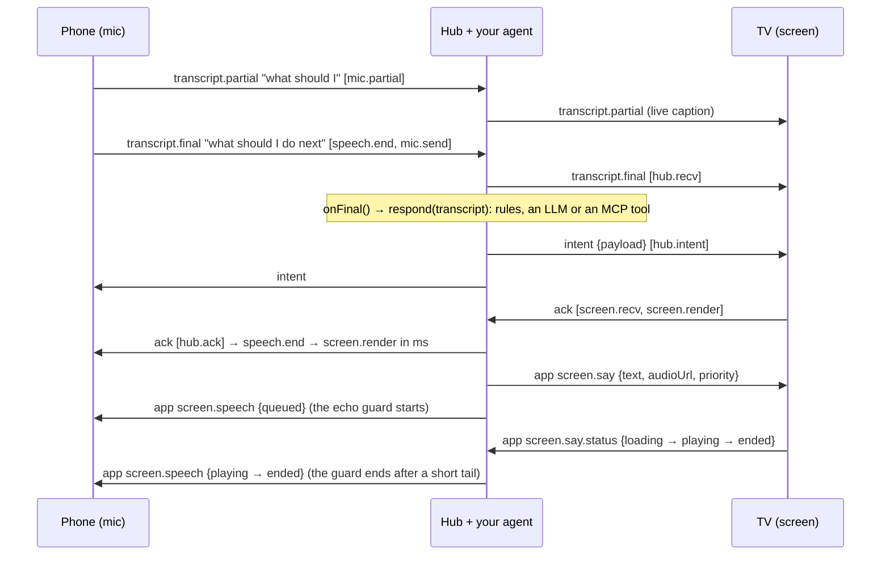

# Design

Why the bridge exists, what it does on the wire, and how it keeps a conversation going. The API is in [api.md](api.md), the numbers in [measurement.md](measurement.md).

The phone's own recognizer turns speech into text. Your `onFinal` handler, whether rules, an LLM or an MCP client, decides what it means and what the TV should say. The bridge carries the text both ways, confirms that the TV rendered and played the result, and keeps the TV's own voice from coming back through the phone's microphone. Pairing is the smallest part: the TV shows a 4-character code and a QR code, and the phone joins with it.

## Why

Fire TV's Vega OS has **no app-level speech-to-text API**. Amazon's developer forum says so in two threads: [Speech-to-Text API for a WebView app](https://community.amazondeveloper.com/t/speech-to-text-api-for-a-webview-app/29064) and [Speech-to-text support with manual mic trigger](https://community.amazondeveloper.com/t/speech-to-text-support-with-manual-mic-trigger/27863). What a Vega app gets instead is limited:

- **Keyboard dictation.** The only platform speech-to-text is the system keyboard's one-shot dictation into a focused text field.
- **No WebView mic.** WebView microphone access (`getUserMedia` audio) is not supported for third-party apps ([forum](https://community.amazondeveloper.com/t/issues-with-microphone-access-for-jitsi-integration-on-vega-os/28161)).
- **A privileged raw-audio API.** [`AudioRecordStream`](https://developer.amazon.com/docs/vega-api/0.24/classes.AudioRecordStreamBuilder.amazon-devices_keplerscript-audio-lib.html) sits behind the `com.amazon.audio.privilege.microphone.access` privilege with a run-time grant. It returns raw PCM with no recognizer, so you would ship your own speech-to-text. We have not tested which microphone it reaches on a Fire TV Stick.
- **No app-level text-to-speech either.** VoiceView, the screen reader, is the only platform speech output ([forum](https://community.amazondeveloper.com/t/tts-implementation/24875)).

So a TV app that wants a conversation needs speech-to-text somewhere else, and a way to talk back. Everyone in the room already has a phone with a good mic and a recognizer, so the phone listens. The hard parts are the plumbing:

- getting the words to *this* TV;
- getting an answer back out loud, in audio Vega's media player will actually play;
- keeping the TV's voice out of the phone's mic;
- seeing where the time goes;
- staying connected through TV-runtime quirks and hub restarts.

[docs/vega-notes.md](vega-notes.md) records each Vega quirk we hit and what the bridge does about it.

## Why not…

- **Alexa or Alexa+?** Apart from keyboard dictation, Alexa reaches a Vega app as structured requests: [Content Launcher](https://community.amazondeveloper.com/t/migrating-catalog-and-voice-integration-from-fire-os-to-vega/4341) (launch or search content), media controls (play, pause) and UI-controller selection ([forum](https://community.amazondeveloper.com/t/is-it-posible-to-create-custom-voice-commands-on-vega/27800)). None of them gives the app the user's own words, and none lets the app answer in its own voice. The bridge is the free-form conversation inside your app: your agent hears every word and the TV answers out loud. The two fit together: Alexa launches your app, and the bridge talks inside it. There is no wake word: the user holds the phone's button, or turns on hands-free.
- **Keyboard dictation?** It suits a search box. The user holds the remote's mic button and one final string lands in a focused `TextInput`. There are no partials, the app cannot start listening on its own, and there is no way back (the TV saying something) and no timing. A conversation needs every one of those.
- **[Matter Casting](https://developer.amazon.com/docs/vega/0.24/vega-matter-casting-integration.html)?** It is the official phone-to-Vega companion path. It covers launching content, media playback controls and switching between an app's targets, and it carries no free-form app messages, audio or speech. Use Matter to launch your app, and the bridge to talk to it.
- **A bare socket library?** Generic WebSocket rooms give you transport. You would still build all of the following:
  - roles and pairing codes, with guess limits;
  - transcript, intent and ack semantics;
  - a speech back-channel with playback status, and the echo guard;
  - hop timing with clock sync;
  - reconnect and dead-link detection for TV runtimes;
  - a conformance suite so a second platform can join.

  That is this package.

## Browsers

The phone side is a web page, so voice depends on the phone's browser. Every browser can type instead.

| Browser | Voice | Notes |
|---|---|---|
| Chrome on Android | Yes, over https | Or over plain http with Chrome's per-device developer flag ([docs/https.md](https.md#1-chrome-on-your-own-android-phone-the-developer-flag)) |
| Safari 26 and later (iPhone, iPad, Mac) | Yes, over https only | Siri must be on. On a plain-http page Safari has no recognizer at all |
| Other browsers on iPhone | Not verified | Reported to have no speech recognition; open the page in Safari |
| Chrome or Safari on a desktop | Yes, over https or `localhost` | `http://localhost:<port>/p/<code>` on the hub's own computer works with no certificate |
| Brave | Desktop: no | Brave turns recognition results off ([issue](https://github.com/brave/brave-browser/issues/2802)); mobile not verified |
| Firefox | No | No speech recognition |

The phone page checks this itself (`voiceSupport()` in `./phone`): over plain http it says why voice is off, lists the fixes with the page's own address filled in, and keeps typing. [docs/https.md](https.md) has the four ways to get https: Chrome's developer flag, a tunnel, a local certificate authority for an iPhone, and `localhost`.

## Where speech is recognized

The phone sends the hub text, never audio. The recognition happens in the phone's browser, with that browser's speech service:

- **Safari:** Apple's speech recognition, the service behind Siri and dictation (Siri must be on).
- **Chrome on Android:** Google's speech servers.
- **Chrome on a desktop:** Google's servers by default. Since Chrome 139 a page can ask for on-device recognition ([`processLocally`](https://chromestatus.com/feature/6090916291674112)); `./phone` does not ask for it yet.

What the hub and your `onFinal` do with the text is your app's privacy surface. The hub stores nothing ([SECURITY.md](../SECURITY.md)).

## The round trip

Every utterance carries `hops: [{hop, at}]` in **hub clock**. Each client estimates its offset to the hub from `welcome` and ping/pong samples, keeping the lowest-RTT one. Hops are appended in order and never reordered:

| Leg | What it measures |
|---|---|
| `speech.end → mic.send` | The phone recognizer's tail: from silence to a final result |
| `mic.send → hub.recv` | Phone to hub network |
| `hub.recv → hub.intent` | **Your app or agent** (`onFinal`) |
| `hub.intent → screen.recv` | Hub to TV network |
| `screen.recv → screen.render` | The TV drawing the result (stamped after the frame that shows it) |
| `screen.render → hub.ack` | TV to hub (the confirmation, not user-visible) |
| `screen.say` sent → `screen.say.status: playing` | The TV loading and starting the reply's audio (`at` is hub clock) |

`latency(ack.hops).span('speech.end', 'screen.render')` gives the user-visible number, and `.legs` gives each leg. Taps use `input.end` instead of `speech.end`. `./phone` also stamps `speech.start`, so `speech.start → speech.end` is how long the user spoke.

## The echo guard

The phone's microphone and the TV's speaker are in the same room. A phone that keeps listening hears the TV's reply, and without a guard it would send the TV's words back as the user's next utterance. Then the agent answers itself.

The hub tells each phone what the TV is saying, on `screen.speech`. It sends `queued` when your app sends a say line, then relays each playback report the TV sends (`loading`, `playing`, `ended`, `interrupted`, `error`, `no-audio`). The notices never carry the audio URL. `createPhoneMic` uses them like this:

- **Drop while the TV is audible.** From `queued` until `ended`, `interrupted` or `error`, plus a short tail (`tailMs`, 700 ms), whatever the mic hears is dropped, and it reports `dropped` with reason `echo`. `mode: 'pause'` aborts the recognizer instead and restarts it after the line, in continuous mode. A `no-audio` (captions only) line releases at once.
- **Never stuck.** A screen that never reports holds the guard only for the line's `durationMs` plus slack. Every hold is capped at `maxHoldMs` (20 s).
- **Late echoes.** A final that repeats the TV's last words a few seconds after a line is dropped too (reason `echo-text`). It needs at least three words that are mostly the line's, or the whole line, so a short "yes" gets through.
- **Barge-in** (`bargeIn: true`). The user talks over the TV: speech during a line that has at least two words and is mostly not the line's own words. The phone then sends `screen.say.stop`, and the TV stops and drops its queue. What the user said is kept. In push-to-talk, pressing the button while the TV talks is itself a barge-in, and `mic.interrupt()` is a stop button. Automatic barge-in needs the line's text, so it is off for lines a screen reports without `text`.

The TV side honours `screen.say.stop` in `useVoiceBridge` (default) and in the example web TV, and both report every line they drop. Mixed versions work. A 0.2 hub sends no notices, so a 0.3 or later phone's guard never engages. A 0.2 screen ignores stops, but its playback reports still drive the guard. The wire details are in [PROTOCOL.md](../PROTOCOL.md#101-the-echo-guard-screenspeech-and-screensaystop-revision-3).

## Staying connected

With `reconnect` on (the default), the client keeps the link up until `close()`:

- **Backoff:** capped exponential, 250 ms doubling to 10 s, with half of each delay random.
- **Dead links:** the heartbeat pings every 10 s and drops the link after 25 s of silence.
- **Hub restarts:** a phone that gets back before the TV keeps retrying `unknown-code` while the TV re-creates its room with the same code. After `repairAfterMs` (60 s) it stops with status `repair`.
- **Fatal answers:** `version`, `id-in-use`, and a wrong code on a first pairing stop the client.

To keep a `clientId` across page reloads, persist **both** `client.clientId` and `client.resumeToken` and pass them back in. The token proves that the new connection owns the id, and lets it back into its room even while the hub has paused pairing. Never display or log the token.

## Security

A pairing code is 4 characters from a 31-character alphabet (923,521 codes). Anyone who can see the TV can join, which is the point in a living room and wrong for anything sensitive. What the hub does about the rest:

- **Guessing is throttled,** per client address (30 wrong codes a minute; an IPv6 client counts as its /64) and across the whole hub (100 per 10 minutes, after which pairing pauses for every code, the right one too, so a refusal tells a guesser nothing). Peers already paired, and peers resuming with their token, stay in.
- **Pages on other sites cannot connect** to the CLI hub or the Vega voice loop's hub: they check `Origin`, and `BridgeHub` offers the same check as `allowedOrigins`.
- **Rooms do not outlive the TV,** errors do not carry exception text, `screen.speech` never carries audio URLs, a `clientId` can be taken over only with its `resumeToken`, and the hub answers only with WebSocket subprotocols it was told it may select.
- **Serve https/wss beyond your own LAN.** Over plain ws, transcripts are readable on the network.

[SECURITY.md](../SECURITY.md) has the threat table, what is not covered (no end-to-end encryption, no PAKE), and how to report a vulnerability.

## Known limits (all)

- **The Fire TV Stick is not measured yet.** Every Vega number here is from the Vega Virtual Device. Version 0.3.5 has run on a stick inside Spee, with no measurements. [scripts/stick-run.md](../scripts/stick-run.md) is the measured run, step by step.
- **Plain-http audio in URL mode, after Amazon's September 2026 OS update,** and **what happens when Alexa backgrounds the app,** are untested; both are steps of the stick run. The client's heartbeat and reconnect should recover a suspended connection.
- **`AudioRecordStream` is untested.** We have not tested which microphone it reaches on a stick (see Why).
- **No end-to-end encryption.** Transport security is TLS between each device and the hub.
- **One hub process holds all rooms in memory.** There is no clustering.
- **The echo guard is a heuristic.** It trusts the TV's playback reports, and it holds for a capped time when there are none. Barge-in and late-echo detection compare words with the TV's line, so a recognizer that badly mishears the TV can fool them. Room acoustics are not modelled.
- **`./phone` relies on the browser's recognizer** ([Browsers](#browsers)), and its timing events vary by engine, so `speech.end` is an estimate.
- **`./react` is tested under React 18** with react-test-renderer and a host-component mock of `react-native`; the Vega example uses React 19.2 and type-checks in CI.
- **The Dockerfile's steps were rehearsed outside a container** (install, build, pack, install the tarball, start the CLI). The image itself has not been built in this repo.

## Used by

- **Spee**, my speaking coach on Bee. Its Fire TV app joins the bridge as the screen and its phone page as the mic, from a vendored copy of version 0.3.5. Spee's repository is not public, so there is no link.
- The bridge started inside **Rack Board**, a Fire TV training board I prototyped before Spee, where the phone logs sets by voice and the TV coaches out loud. Rack Board stayed a private prototype.
